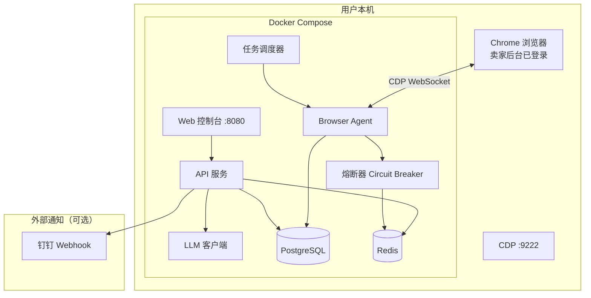
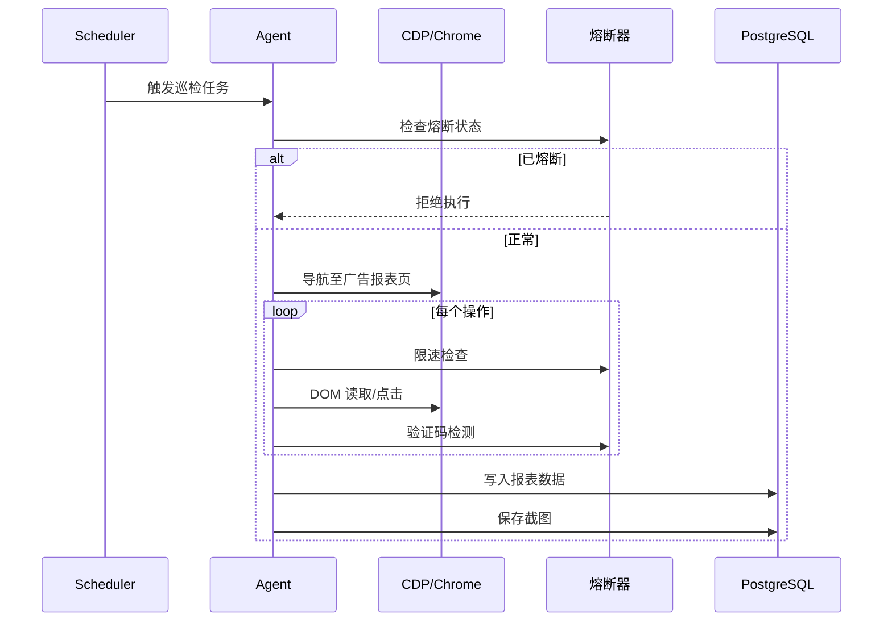
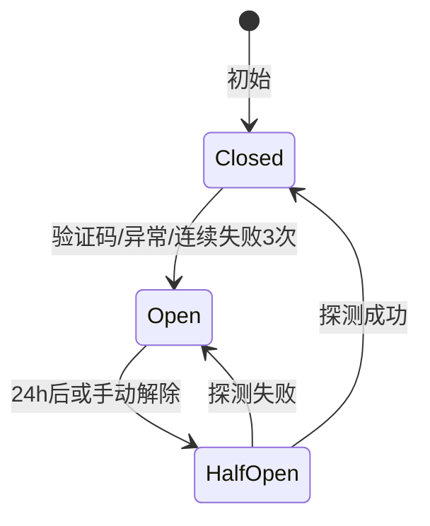

# 02-技术架构与数据设计

> **软件名称**：跨境卖家店铺智能巡检与广告优化辅助系统 V1.0  
> **文档版本**：V1.0  
> **编写日期**：2026-07-19

---

## 1. 架构总览

### 1.1 系统架构图（本地部署）



### 1.2 Agent 执行流程



### 1.3 技术选型

| 层 | 选型 | 说明 |
|----|------|------|
| Agent 引擎 | Python + Playwright/CDP | 参考 browser-use 思路自研 |
| 后端 API | FastAPI | 轻量本地服务 |
| 前端 | Vue 3 + Element Plus | 本地控制台 |
| 调度 | APScheduler + Redis 锁 | 防重复执行 |
| 数据库 | PostgreSQL 15 | 本地持久化 |
| 缓存/熔断状态 | Redis 7 | 熔断标志、限速计数 |
| LLM | Ollama 本地 / 云端 API | 日报摘要 |
| 部署 | Docker Compose | 一键本地 |

---

## 2. 核心模块

### 2.1 Chrome CDP 连接模块

**连接方式**：用户手动启动 Chrome：

```bash
# Windows
chrome.exe --remote-debugging-port=9222 --user-data-dir="C:\ChromeProfiles\AmazonUS"

# macOS
/Applications/Google\ Chrome.app/Contents/MacOS/Google\ Chrome \
  --remote-debugging-port=9222 \
  --user-data-dir="$HOME/ChromeProfiles/AmazonUS"
```

**Agent 连接**：

```python
async def connect_cdp(endpoint: str = "http://127.0.0.1:9222"):
    browser = await playwright.chromium.connect_over_cdp(endpoint)
    context = browser.contexts[0]
    return context
```

### 2.2 Profile 管理模块

| 字段 | 说明 |
|------|------|
| profile_id | UUID |
| name | 显示名「美国店」 |
| cdp_endpoint | 默认 127.0.0.1:9222 |
| user_data_dir | Chrome 配置路径 |
| platform | amazon / tiktok |
| marketplace | US / UK / ... |
| status | active / disconnected |

**隔离原则**：每个 Profile 独立 Chrome 进程与用户目录，禁止跨 Profile 复用 Cookie。

### 2.3 广告巡检模块（Amazon SP）

**步骤脚本（版本化）**：

```yaml
# scripts/amazon_sp_report_v1.yaml
version: "1.0.0"
platform: amazon
task: sp_campaign_report
steps:
  - action: navigate
    url: "https://advertising.amazon.com/cm/campaigns"
  - action: wait
    selector: "[data-testid='campaign-table']"
    timeout: 30000
  - action: click
    selector: "[data-testid='date-range-picker']"
  - action: select_date_range
    value: "yesterday"
  - action: extract_table
    selector: "[data-testid='campaign-table']"
    columns:
      - campaign_name
      - spend
      - sales
      - acos
      - impressions
      - clicks
  - action: screenshot
    name: "sp_report_{date}.png"
```

**选择器版本管理**：`scripts/` 目录按平台+版本存放；后台改版时发布 `v1.0.1` 热更新。

### 2.4 Listing 巡检模块

采集字段：

| 字段 | 来源 |
|------|------|
| asin | 库存管理页 |
| title | 商品详情 |
| status | Active/Inactive/Suppressed |
| suppression_reason | 异常时 |
| quantity | FBA/FBM 库存 |
| buy_box | 是否持有 |
| new_reviews_7d | 评价页摘要 |

### 2.5 熔断器模块（Circuit Breaker）



**检测规则**：

| 类型 | 检测方式 |
|------|----------|
| CAPTCHA | DOM 含 `captcha`/`robot`/`automated` |
| 频率限制 | HTTP 429 或页面提示 |
| 登录失效 | 跳转登录页 |
| 连续失败 | 同任务 3 次异常 |

**熔断后行为**：
- 停止所有 Agent 任务  
- Redis 写入 `circuit_breaker:open` TTL 24h  
- 推送 P0 告警  
- 记录截图与 DOM 快照  

### 2.6 限速模块

```python
class RateLimiter:
    def __init__(self, min_interval_ms=3000, max_daily_ops=200):
        self.min_interval_ms = min_interval_ms
        self.max_daily_ops = max_daily_ops

    async def acquire(self, profile_id: str):
        # Redis INCR daily_ops:{profile_id}:{date}
        # Redis 检查 last_action_at
        pass
```

### 2.7 AI 摘要模块

输入：昨日广告数据 + Listing 异常列表  
输出：Markdown 日报 + 3–5 条建议

---

## 3. 数据模型（字段级）

### 3.1 ER 图

```mermaid
erDiagram
    profiles ||--o{ patrol_tasks : runs
    patrol_tasks ||--o{ patrol_logs : logs
    profiles ||--o{ ad_campaign_reports : stores
    profiles ||--o{ listing_snapshots : stores
    profiles ||--o{ alerts : triggers
    patrol_tasks ||--o{ screenshots : captures
    circuit_breaker_events ||--|| profiles : affects

    profiles {
        uuid id PK
        string name
        string platform
        string marketplace
        string cdp_endpoint
        string user_data_dir
        string status
        jsonb rate_limit_config
        timestamp created_at
    }

    patrol_tasks {
        uuid id PK
        uuid profile_id FK
        string task_type
        string schedule_cron
        string status
        jsonb config
        boolean enabled
        timestamp last_run_at
        timestamp next_run_at
    }

    patrol_logs {
        uuid id PK
        uuid task_id FK
        uuid profile_id FK
        string status
        int duration_ms
        int page_ops_count
        text error_message
        jsonb metadata
        timestamp started_at
        timestamp finished_at
    }

    ad_campaign_reports {
        uuid id PK
        uuid profile_id FK
        date report_date
        string campaign_id
        string campaign_name
        decimal spend
        decimal sales
        decimal acos
        int impressions
        int clicks
        decimal ctr
        decimal cvr
        string currency
        timestamp collected_at
    }

    listing_snapshots {
        uuid id PK
        uuid profile_id FK
        string asin
        string sku
        string title
        string status
        text suppression_reason
        int quantity
        boolean has_buy_box
        int new_negative_reviews_7d
        timestamp collected_at
    }

    daily_reports {
        uuid id PK
        uuid profile_id FK
        date report_date
        text summary_md
        jsonb suggestions
        jsonb metrics_snapshot
        timestamp generated_at
    }

    alerts {
        uuid id PK
        uuid profile_id FK
        string level
        string category
        string title
        text message
        jsonb context
        boolean acknowledged
        timestamp created_at
    }

    screenshots {
        uuid id PK
        uuid patrol_log_id FK
        string file_path
        string page_url
        timestamp captured_at
    }

    circuit_breaker_events {
        uuid id PK
        uuid profile_id FK
        string reason
        string trigger_type
        text detail
        timestamp triggered_at
        timestamp resolved_at
        uuid resolved_by
    }

    audit_logs {
        uuid id PK
        string action
        string actor
        jsonb detail
        timestamp created_at
    }
```



### 3.2 索引建议

```sql
CREATE INDEX idx_ad_reports_profile_date ON ad_campaign_reports(profile_id, report_date);
CREATE INDEX idx_listing_profile_asin ON listing_snapshots(profile_id, asin, collected_at DESC);
CREATE UNIQUE INDEX idx_ad_reports_unique ON ad_campaign_reports(profile_id, report_date, campaign_id);
```

---

## 4. 核心 API

**Base**：`http://localhost:8080/api/v1`（仅本机访问）

### 4.1 系统

| 方法 | 路径 | 说明 |
|------|------|------|
| GET | `/health` | 健康检查 |
| GET | `/system/status` | CDP/熔断/调度器状态 |

### 4.2 Profile

| 方法 | 路径 | 说明 |
|------|------|------|
| GET | `/profiles` | 列表 |
| POST | `/profiles` | 创建 |
| POST | `/profiles/{id}/test-connection` | 测试 CDP |
| PUT | `/profiles/{id}/rate-limit` | 限速配置 |

### 4.3 任务

| 方法 | 路径 | 说明 |
|------|------|------|
| GET | `/tasks` | 巡检任务列表 |
| POST | `/tasks` | 创建任务 |
| POST | `/tasks/{id}/run` | 手动触发 |
| PUT | `/tasks/{id}/enable` | 启用/禁用 |

### 4.4 数据

| 方法 | 路径 | 说明 |
|------|------|------|
| GET | `/reports/ad` | 广告报表查询 |
| GET | `/reports/ad/export` | CSV 导出 |
| GET | `/listings` | Listing 快照 |
| GET | `/reports/daily/{date}` | 日报 |
| POST | `/reports/daily/generate` | 手动生成日报 |

### 4.5 熔断

| 方法 | 路径 | 说明 |
|------|------|------|
| GET | `/circuit-breaker/status` | 熔断状态 |
| POST | `/circuit-breaker/resolve` | 手动解除（需确认） |

### 4.6 告警

| 方法 | 路径 | 说明 |
|------|------|------|
| GET | `/alerts` | 告警列表 |
| POST | `/alerts/{id}/ack` | 确认告警 |
| PUT | `/settings/notifications` | 钉钉 Webhook 配置 |

---

## 5. AI Prompt 模板

### 5.1 广告日报摘要

```text
你是 Amazon 广告优化顾问。根据以下昨日数据生成简洁日报（中文，400字以内）。

## 昨日数据
{campaigns_json}

## 近7日均值
{avg_7d_json}

## 要求
1. 总览：花费、销售额、ACOS 及环比
2. 异常：指出 ACOS 飙升或花费异常的 Campaign（名称+数据）
3. 建议：3条可执行建议，标注「仅供参考，需人工确认」
4. 禁止建议自动修改竞价

## 输出 Markdown
```

### 5.2 Listing 异常分析

```text
以下 Listing 出现异常，请分析可能原因与处理步骤。

## 异常列表
{anomalies_json}

## 输出 JSON
{
  "items": [
    {
      "asin": "",
      "issue": "",
      "likely_cause": "",
      "action_steps": ["步骤1", "步骤2"],
      "priority": "P0|P1|P2"
    }
  ]
}
```

### 5.3 广告优化建议（只读）

```text
基于近30日 Campaign 表现，给出优化方向建议。

## 数据
{monthly_data}

## 约束
- 仅输出建议，不生成任何自动操作指令
- 考虑预算有限的小卖家场景
- 输出 3-5 条，每条含依据数据

## 输出 JSON
{"suggestions": [{"title": "", "detail": "", "evidence": "", "risk": "低|中|高"}]}
```

---

## 6. 部署方案

### 6.1 前置条件

- Docker Desktop 4.0+  
- Chrome 120+  
- 8GB+ 内存  
- 卖家账号已在 Chrome Profile 登录  

### 6.2 安装步骤

```bash
# 1. 解压安装包
tar -xzf sellerguard-v1.0.tar.gz
cd sellerguard

# 2. 配置
cp .env.example .env
# 编辑 DINGTALK_WEBHOOK、LLM 配置

# 3. 启动
docker compose up -d

# 4. 启动 Chrome（另开终端）
# 见 2.1 节命令

# 5. 打开安装向导
open http://localhost:8080/setup
```

### 6.3 docker-compose.yml

```yaml
version: "3.8"
services:
  api:
    image: sellerguard/api:v1.0
    ports: ["8080:8080"]
    extra_hosts:
      - "host.docker.internal:host-gateway"
    environment:
      - DATABASE_URL=postgresql://sg:sg@postgres/sellerguard
      - REDIS_URL=redis://redis:6379
      - CDP_HOST=host.docker.internal
      - CDP_PORT=9222
    volumes:
      - ./data/screenshots:/data/screenshots
      - ./data/reports:/data/reports

  scheduler:
    image: sellerguard/scheduler:v1.0
    depends_on: [api, redis, postgres]

  postgres:
    image: postgres:15
    volumes: ["pgdata:/var/lib/postgresql/data"]
    environment:
      POSTGRES_DB: sellerguard
      POSTGRES_USER: sg
      POSTGRES_PASSWORD: sg

  redis:
    image: redis:7-alpine

volumes:
  pgdata:
```

### 6.4 网络说明

Agent 容器通过 `host.docker.internal:9222` 连接宿主机 Chrome。Linux 需 `extra_hosts` 配置。

### 6.5 备份

```bash
# 每日 cron
docker compose exec postgres pg_dump -U sg sellerguard > backup_$(date +%Y%m%d).sql
```

### 6.6 安全 checklist

- [ ] Web 控制台仅绑定 127.0.0.1 或内网 IP  
- [ ] 设置管理员密码  
- [ ] 钉钉 Webhook 不含敏感数据明文  
- [ ] 确认 V1.0 写操作闸门关闭  
- [ ] 阅读并签署平台合规声明  

---

## 7. 修订记录

| 版本 | 日期 | 说明 |
|------|------|------|
| V1.0 | 2026-07-19 | 初稿 |
