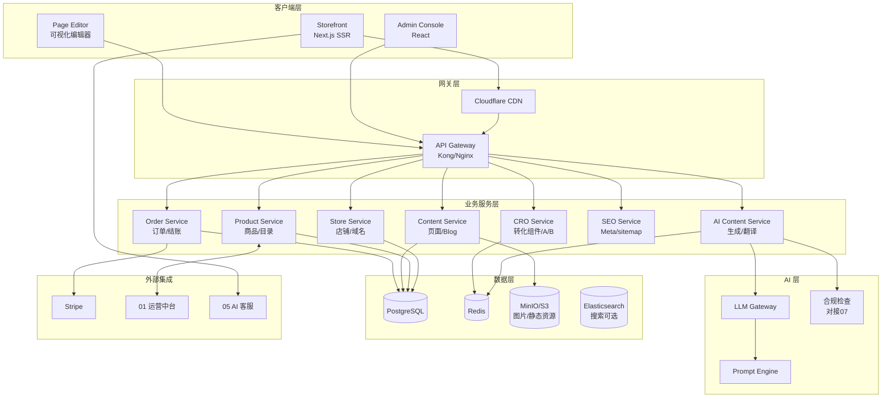
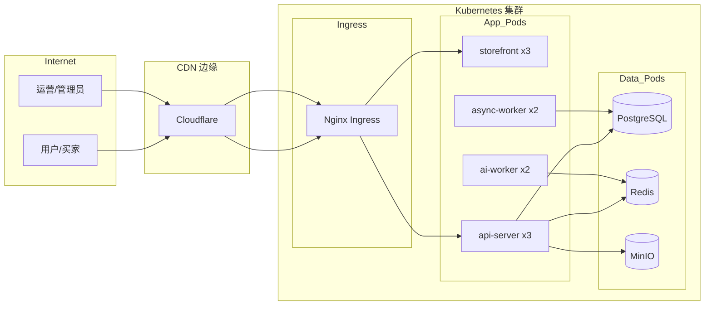

# 02 技术架构与数据设计

> **软件名称**：跨境独立站多语言智能建站与转化管理系统 V1.0  
> **文档版本**：V1.0  
> **最后更新**：2026-07-19

---

## 1. 系统架构总览

### 1.1 逻辑架构图



### 1.2 部署架构图



---

## 2. 技术选型

| 层级 | 技术 | 说明 |
|------|------|------|
| Storefront | Next.js 14 + App Router | SSR/SSG，SEO 友好 |
| Admin | React 18 + Ant Design 5 | 运营控制台 |
| API | NestJS (TypeScript) | 主业务 API |
| 任务队列 | BullMQ + Redis | AI 生成、同步任务 |
| 数据库 | PostgreSQL 15 | 主数据存储 |
| 缓存 | Redis 7 | 会话、页面缓存 |
| 对象存储 | MinIO / S3 | 图片、导出文件 |
| AI | 自研 LLM Gateway | 统一模型调用 |
| 部署 | Docker + K8s / Compose | 私有化友好 |
| 监控 | Prometheus + Grafana | 指标与告警 |

---

## 3. 核心模块设计

### 3.1 Store Service（店铺服务）

**职责**：店铺 CRUD、域名绑定、环境管理、多租户隔离。

**核心流程**：
1. 创建店铺 → 分配 `store_id`、初始化默认语言/币种
2. 绑定域名 → DNS 验证 → SSL 签发（Let's Encrypt）
3. 发布 → 触发 CDN 缓存刷新

### 3.2 Product Service（商品服务）

**职责**：商品、变体、Collection、库存、价格。

**与 01 中台同步**：
```text
01 Webhook(商品变更) → Product Service → 更新本地商品 → 触发 AI 重生成(可选)
```

### 3.3 AI Content Service（AI 内容服务）

**职责**：商品页生成、落地页生成、翻译、Blog。

**处理流程**：
```text
请求 → 组装上下文(商品信息+品牌调性) → Prompt 渲染 → LLM 调用 → 合规检查 → 返回草稿
```

### 3.4 CRO Service（转化服务）

**职责**：转化组件配置、A/B 实验、效果统计。

**组件渲染**：Storefront 通过 API 获取组件配置，客户端渲染，事件埋点回传。

### 3.5 SEO Service

**职责**：Meta 生成、sitemap、hreflang、结构化数据、CWV 监控。

---

## 4. 数据库设计（字段级）

### 4.1 租户与店铺

#### `tenants` 租户表

| 字段 | 类型 | 约束 | 说明 |
|------|------|------|------|
| id | UUID | PK | 租户 ID |
| name | VARCHAR(128) | NOT NULL | 租户名称 |
| plan | VARCHAR(32) | NOT NULL | 套餐：free/standard/pro/enterprise |
| ai_token_quota | INT | DEFAULT 100000 | 月 Token 配额 |
| ai_token_used | INT | DEFAULT 0 | 本月已用 |
| status | VARCHAR(16) | DEFAULT 'active' | active/suspended |
| created_at | TIMESTAMPTZ | NOT NULL | 创建时间 |
| updated_at | TIMESTAMPTZ | NOT NULL | 更新时间 |

#### `stores` 店铺表

| 字段 | 类型 | 约束 | 说明 |
|------|------|------|------|
| id | UUID | PK | 店铺 ID |
| tenant_id | UUID | FK→tenants | 所属租户 |
| name | VARCHAR(128) | NOT NULL | 店铺名称 |
| slug | VARCHAR(64) | UNIQUE | URL 标识 |
| default_locale | VARCHAR(8) | DEFAULT 'en' | 默认语言 |
| default_currency | VARCHAR(8) | DEFAULT 'USD' | 默认币种 |
| timezone | VARCHAR(64) | DEFAULT 'UTC' | 时区 |
| theme_id | UUID | FK→themes | 当前主题 |
| status | VARCHAR(16) | DEFAULT 'draft' | draft/live/archived |
| custom_domain | VARCHAR(256) | NULL | 自定义域名 |
| ssl_status | VARCHAR(16) | DEFAULT 'pending' | pending/active/failed |
| created_at | TIMESTAMPTZ | NOT NULL | |
| updated_at | TIMESTAMPTZ | NOT NULL | |

#### `store_locales` 店铺语言表

| 字段 | 类型 | 约束 | 说明 |
|------|------|------|------|
| id | UUID | PK | |
| store_id | UUID | FK→stores | |
| locale | VARCHAR(8) | NOT NULL | en/de/fr/es/... |
| is_default | BOOLEAN | DEFAULT false | |
| is_published | BOOLEAN | DEFAULT false | |
| created_at | TIMESTAMPTZ | NOT NULL | |

#### `store_currencies` 店铺币种表

| 字段 | 类型 | 约束 | 说明 |
|------|------|------|------|
| id | UUID | PK | |
| store_id | UUID | FK→stores | |
| currency | VARCHAR(8) | NOT NULL | USD/EUR/GBP/... |
| exchange_rate | DECIMAL(12,6) | NOT NULL | 相对默认币种汇率 |
| is_default | BOOLEAN | DEFAULT false | |
| updated_at | TIMESTAMPTZ | NOT NULL | 汇率更新时间 |

### 4.2 商品

#### `products` 商品表

| 字段 | 类型 | 约束 | 说明 |
|------|------|------|------|
| id | UUID | PK | |
| store_id | UUID | FK→stores | |
| sku | VARCHAR(64) | NOT NULL | SKU 编码 |
| status | VARCHAR(16) | DEFAULT 'draft' | draft/active/archived |
| price | DECIMAL(12,2) | NOT NULL | 基础价格 |
| compare_at_price | DECIMAL(12,2) | NULL | 划线价 |
| inventory_qty | INT | DEFAULT 0 | 库存 |
| weight | DECIMAL(8,2) | NULL | 重量(kg) |
| external_id | VARCHAR(128) | NULL | 01 中台 ID |
| created_at | TIMESTAMPTZ | NOT NULL | |
| updated_at | TIMESTAMPTZ | NOT NULL | |

#### `product_translations` 商品翻译表

| 字段 | 类型 | 约束 | 说明 |
|------|------|------|------|
| id | UUID | PK | |
| product_id | UUID | FK→products | |
| locale | VARCHAR(8) | NOT NULL | |
| title | VARCHAR(512) | NOT NULL | 标题 |
| description | TEXT | NULL | 详情(HTML) |
| meta_title | VARCHAR(128) | NULL | SEO 标题 |
| meta_description | VARCHAR(256) | NULL | SEO 描述 |
| ai_generated | BOOLEAN | DEFAULT false | 是否 AI 生成 |
| review_status | VARCHAR(16) | DEFAULT 'pending' | pending/approved/rejected |
| created_at | TIMESTAMPTZ | NOT NULL | |
| updated_at | TIMESTAMPTZ | NOT NULL | |

#### `product_variants` 商品变体表

| 字段 | 类型 | 约束 | 说明 |
|------|------|------|------|
| id | UUID | PK | |
| product_id | UUID | FK→products | |
| sku | VARCHAR(64) | NOT NULL | 变体 SKU |
| option1 | VARCHAR(64) | NULL | 如 Color |
| option1_value | VARCHAR(64) | NULL | 如 Red |
| option2 | VARCHAR(64) | NULL | 如 Size |
| option2_value | VARCHAR(64) | NULL | 如 M |
| price | DECIMAL(12,2) | NULL | 变体价格(覆盖) |
| inventory_qty | INT | DEFAULT 0 | |
| image_url | VARCHAR(512) | NULL | |

#### `product_images` 商品图片表

| 字段 | 类型 | 约束 | 说明 |
|------|------|------|------|
| id | UUID | PK | |
| product_id | UUID | FK→products | |
| url | VARCHAR(512) | NOT NULL | 图片 URL |
| alt_text | VARCHAR(256) | NULL | |
| position | INT | DEFAULT 0 | 排序 |

#### `collections` 集合表

| 字段 | 类型 | 约束 | 说明 |
|------|------|------|------|
| id | UUID | PK | |
| store_id | UUID | FK→stores | |
| slug | VARCHAR(128) | NOT NULL | URL slug |
| type | VARCHAR(16) | DEFAULT 'manual' | manual/automated |
| rules | JSONB | NULL | 自动集合规则 |
| created_at | TIMESTAMPTZ | NOT NULL | |

### 4.3 页面与内容

#### `pages` 页面表

| 字段 | 类型 | 约束 | 说明 |
|------|------|------|------|
| id | UUID | PK | |
| store_id | UUID | FK→stores | |
| type | VARCHAR(32) | NOT NULL | home/landing/blog/custom |
| slug | VARCHAR(128) | NOT NULL | |
| status | VARCHAR(16) | DEFAULT 'draft' | draft/published |
| published_at | TIMESTAMPTZ | NULL | |
| created_at | TIMESTAMPTZ | NOT NULL | |

#### `page_blocks` 页面区块表

| 字段 | 类型 | 约束 | 说明 |
|------|------|------|------|
| id | UUID | PK | |
| page_id | UUID | FK→pages | |
| locale | VARCHAR(8) | NOT NULL | |
| block_type | VARCHAR(64) | NOT NULL | hero/features/cta/... |
| content | JSONB | NOT NULL | 区块内容 JSON |
| position | INT | DEFAULT 0 | |
| created_at | TIMESTAMPTZ | NOT NULL | |

### 4.4 转化组件

#### `cro_components` 转化组件表

| 字段 | 类型 | 约束 | 说明 |
|------|------|------|------|
| id | UUID | PK | |
| store_id | UUID | FK→stores | |
| type | VARCHAR(32) | NOT NULL | countdown/urgency/popup/sticky_cta/trust_badge |
| name | VARCHAR(128) | NOT NULL | 组件名称 |
| config | JSONB | NOT NULL | 样式/文案/触发条件 |
| target_pages | JSONB | NULL | 生效页面列表 |
| is_active | BOOLEAN | DEFAULT true | |
| created_at | TIMESTAMPTZ | NOT NULL | |

#### `ab_experiments` A/B 实验表

| 字段 | 类型 | 约束 | 说明 |
|------|------|------|------|
| id | UUID | PK | |
| store_id | UUID | FK→stores | |
| name | VARCHAR(128) | NOT NULL | |
| target_type | VARCHAR(32) | NOT NULL | page/component |
| target_id | UUID | NOT NULL | |
| variant_a | JSONB | NOT NULL | 对照组配置 |
| variant_b | JSONB | NOT NULL | 实验组配置 |
| traffic_split | INT | DEFAULT 50 | B 组流量百分比 |
| status | VARCHAR(16) | DEFAULT 'running' | draft/running/paused/completed |
| winner | VARCHAR(8) | NULL | a/b/none |
| started_at | TIMESTAMPTZ | NULL | |
| ended_at | TIMESTAMPTZ | NULL | |
| created_at | TIMESTAMPTZ | NOT NULL | |

#### `ab_events` A/B 事件表

| 字段 | 类型 | 约束 | 说明 |
|------|------|------|------|
| id | BIGSERIAL | PK | |
| experiment_id | UUID | FK→ab_experiments | |
| variant | VARCHAR(8) | NOT NULL | a/b |
| event_type | VARCHAR(32) | NOT NULL | impression/click/conversion |
| session_id | VARCHAR(64) | NOT NULL | |
| created_at | TIMESTAMPTZ | NOT NULL | |

### 4.5 AI 与 SEO

#### `ai_generation_logs` AI 生成日志

| 字段 | 类型 | 约束 | 说明 |
|------|------|------|------|
| id | UUID | PK | |
| store_id | UUID | FK→stores | |
| task_type | VARCHAR(32) | NOT NULL | product_page/landing/translate/blog |
| target_id | UUID | NULL | 关联商品/页面 ID |
| prompt_hash | VARCHAR(64) | NOT NULL | Prompt 哈希 |
| model | VARCHAR(64) | NOT NULL | 使用模型 |
| tokens_in | INT | NOT NULL | |
| tokens_out | INT | NOT NULL | |
| status | VARCHAR(16) | NOT NULL | success/failed |
| error_message | TEXT | NULL | |
| created_at | TIMESTAMPTZ | NOT NULL | |

#### `seo_reports` SEO 检查报告

| 字段 | 类型 | 约束 | 说明 |
|------|------|------|------|
| id | UUID | PK | |
| store_id | UUID | FK→stores | |
| score | INT | NOT NULL | 0-100 |
| issues | JSONB | NOT NULL | 问题列表 |
| created_at | TIMESTAMPTZ | NOT NULL | |

---

## 5. 核心 API 设计

### 5.1 认证

所有 API 使用 Bearer Token（JWT），Header：`Authorization: Bearer <token>`

### 5.2 店铺 API

```
POST   /api/v1/stores                    # 创建店铺
GET    /api/v1/stores                    # 列表
GET    /api/v1/stores/:id                # 详情
PATCH  /api/v1/stores/:id                # 更新
POST   /api/v1/stores/:id/publish        # 发布上线
POST   /api/v1/stores/:id/domains        # 绑定域名
```

### 5.3 商品 API

```
POST   /api/v1/stores/:storeId/products           # 创建商品
GET    /api/v1/stores/:storeId/products           # 列表(分页/筛选)
GET    /api/v1/products/:id                       # 详情
PATCH  /api/v1/products/:id                       # 更新
DELETE /api/v1/products/:id                       # 删除
POST   /api/v1/stores/:storeId/products/import    # 批量导入
POST   /api/v1/products/:id/translations          # 添加翻译
```

### 5.4 AI 内容 API

```
POST   /api/v1/ai/generate/product-page    # 生成商品页
POST   /api/v1/ai/generate/landing-page    # 生成落地页
POST   /api/v1/ai/translate                # 翻译
POST   /api/v1/ai/generate/blog            # 生成 Blog
GET    /api/v1/ai/tasks/:taskId            # 查询异步任务状态
```

**生成商品页请求示例**：
```json
{
  "product_id": "uuid",
  "locale": "en",
  "tone": "professional",
  "include_faq": true,
  "keywords": ["wireless earbuds", "noise cancelling"]
}
```

**响应示例**：
```json
{
  "task_id": "uuid",
  "status": "completed",
  "result": {
    "title": "Premium Wireless Earbuds with Active Noise Cancellation",
    "description": "<p>...</p>",
    "bullet_points": ["30-hour battery", "IPX5 waterproof"],
    "faq": [{"q": "...", "a": "..."}],
    "meta_title": "...",
    "meta_description": "..."
  }
}
```

### 5.5 转化组件 API

```
POST   /api/v1/stores/:storeId/cro/components     # 创建组件
GET    /api/v1/stores/:storeId/cro/components     # 列表
PATCH  /api/v1/cro/components/:id                 # 更新
GET    /api/v1/stores/:storeId/cro/components/active  # Storefront 获取生效组件
```

### 5.6 A/B 实验 API

```
POST   /api/v1/stores/:storeId/ab/experiments     # 创建实验
GET    /api/v1/ab/experiments/:id/report          # 实验报告
POST   /api/v1/ab/experiments/:id/complete        # 结束并选择胜者
POST   /api/v1/ab/events                          # 埋点上报
```

### 5.7 SEO API

```
GET    /api/v1/stores/:storeId/seo/report         # SEO 检查报告
GET    /api/v1/stores/:storeId/sitemap.xml        # sitemap
POST   /api/v1/stores/:storeId/seo/fix            # 自动修复可修复项
```

---

## 6. AI Prompt 模板

### 6.1 商品页生成 Prompt

```text
你是一位专业的跨境电商文案专家，擅长撰写高转化率的商品详情页。

## 商品信息
- 商品名称：{{product_name}}
- SKU：{{sku}}
- 品类：{{category}}
- 核心卖点（用户提供）：{{selling_points}}
- 目标市场：{{target_market}}
- 品牌调性：{{brand_tone}}

## 要求
1. 标题：60 字符以内，包含核心关键词，吸引点击
2. 卖点（Bullet Points）：5 条，每条突出一个用户利益
3. 详情描述：300-500 词，分段落，包含使用场景
4. FAQ：3-5 个常见问题
5. SEO Meta Title：60 字符以内
6. SEO Meta Description：150 字符以内

## 禁止
- 使用夸大宣传词（best ever, #1, guaranteed）
- 提及竞品品牌
- 虚假承诺

## 输出格式
严格输出 JSON：
{
  "title": "",
  "bullet_points": [],
  "description": "",
  "faq": [{"question": "", "answer": ""}],
  "meta_title": "",
  "meta_description": ""
}
```

### 6.2 多语言翻译 Prompt

```text
你是一位专业的跨境电商本地化翻译专家。

## 任务
将以下商品内容从 {{source_locale}} 翻译为 {{target_locale}}。

## 原文
{{source_content_json}}

## 要求
1. 符合目标市场语言习惯，非机械翻译
2. 保留品牌名不翻译
3. 尺寸/重量单位转换为目标市场常用单位
4. SEO 关键词本地化
5. 保持 JSON 结构不变

## 术语表
{{glossary}}

## 输出
仅输出翻译后的 JSON，不要其他内容。
```

### 6.3 落地页生成 Prompt

```text
你是一位 DTC 品牌落地页策划专家。

## 活动信息
- 活动主题：{{campaign_theme}}
- 目标受众：{{target_audience}}
- 核心优惠：{{offer}}
- 截止日期：{{deadline}}
- 品牌调性：{{brand_tone}}

## 要求
生成落地页区块内容，包含：
1. Hero 区：主标题 + 副标题 + CTA 按钮文案
2. 特性区：3-4 个特性，每个含标题和描述
3. 社会证明：评价引用（可虚构风格但需标注）
4. 紧迫感区：倒计时文案
5. 最终 CTA 区

## 输出格式
JSON 数组，每个元素：
{"block_type": "hero|features|social_proof|urgency|cta", "content": {...}}
```

---

## 7. 部署方案

### 7.1 Docker Compose（开发/小规模私有化）

```yaml
# docker-compose.yml 核心服务
services:
  api:
    image: dtc-builder-api:latest
    ports: ["3000:3000"]
    environment:
      DATABASE_URL: postgres://user:pass@db:5432/dtc
      REDIS_URL: redis://redis:6379
      LLM_GATEWAY_URL: http://llm-gateway:8080
    depends_on: [db, redis]

  storefront:
    image: dtc-builder-storefront:latest
    ports: ["3001:3000"]
    environment:
      API_URL: http://api:3000

  ai-worker:
    image: dtc-builder-ai-worker:latest
    environment:
      REDIS_URL: redis://redis:6379
    depends_on: [redis]

  db:
    image: postgres:15
    volumes: ["pgdata:/var/lib/postgresql/data"]

  redis:
    image: redis:7-alpine

  minio:
    image: minio/minio
    command: server /data
    volumes: ["miniodata:/data"]
```

### 7.2 生产环境清单

| 组件 | 规格 | 数量 | 说明 |
|------|------|------|------|
| API Server | 2C4G | 3 | 无状态，可水平扩展 |
| Storefront | 2C4G | 3 | SSR 节点 |
| AI Worker | 4C8G | 2 | 异步 AI 任务 |
| PostgreSQL | 4C16G | 1主1从 | 主从复制 |
| Redis | 2C4G | 1主1从 | 哨兵模式 |
| MinIO | 4C8G | 3 | 分布式存储 |

### 7.3 环境变量

| 变量 | 必填 | 说明 |
|------|------|------|
| DATABASE_URL | 是 | PostgreSQL 连接串 |
| REDIS_URL | 是 | Redis 连接串 |
| S3_ENDPOINT | 是 | 对象存储 |
| LLM_GATEWAY_URL | 是 | AI 网关 |
| JWT_SECRET | 是 | JWT 签名密钥 |
| STRIPE_SECRET_KEY | 否 | 支付 |
| CLOUDFLARE_API_TOKEN | 否 | CDN/SSL |

### 7.4 CI/CD 流程

```text
Git Push → GitHub Actions → 单元测试 → 构建镜像 → 推送 Registry → K8s 滚动更新 → 健康检查
```

---

## 8. 安全设计

| 措施 | 实现 |
|------|------|
| 租户隔离 | 所有查询带 tenant_id 过滤 |
| API 鉴权 | JWT + RBAC |
| 敏感数据 | 支付信息不存储 |
| 审计日志 | 关键操作记录 |
| 限流 | API Gateway 100 req/s/租户 |
| HTTPS | 强制 TLS 1.2+ |

---

**审批**：架构师 ______  DBA ______  日期 ______
