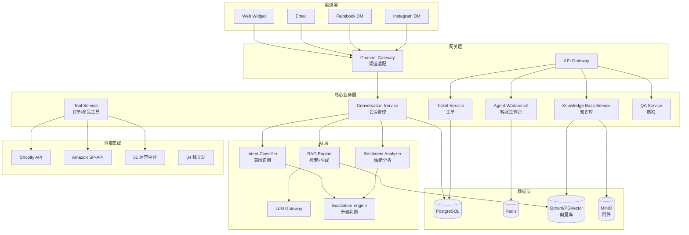
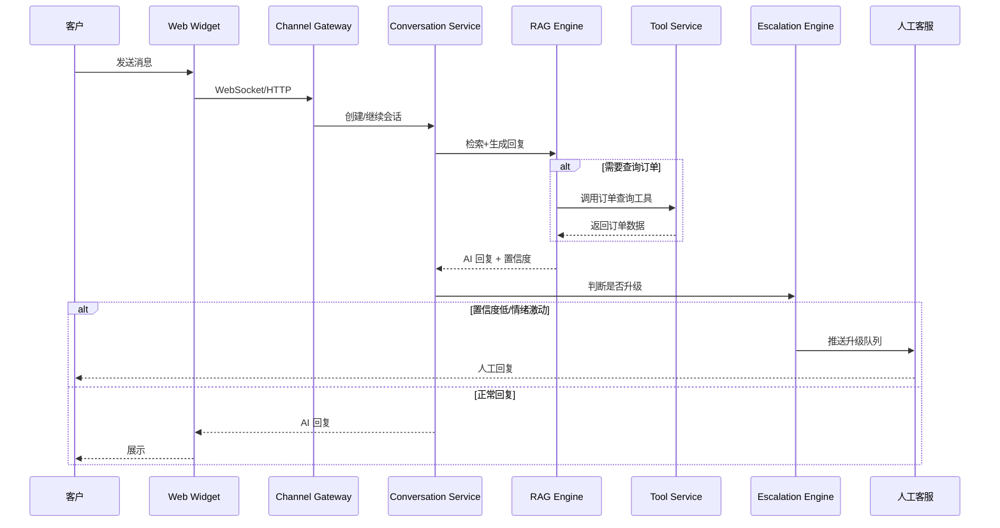

# 02 技术架构与数据设计

> **软件名称**：跨境电商多语言智能客服与售后工单系统 V1.0  
> **文档版本**：V1.0  
> **最后更新**：2026-07-19

---

## 1. 系统架构总览

### 1.1 逻辑架构图



### 1.2 会话处理流程



---

## 2. 技术选型

| 层级 | 技术 | 说明 |
|------|------|------|
| Widget | React + WebSocket | 嵌入式聊天组件 |
| 工作台 | React + Ant Design | 客服操作界面 |
| API | FastAPI (Python) | 主业务 API，AI 生态友好 |
| RAG | LangChain + Qdrant | 检索增强生成 |
| 向量库 | Qdrant / PGVector | 知识库向量存储 |
| 任务队列 | Celery + Redis | 异步任务、邮件处理 |
| 数据库 | PostgreSQL 15 | 主数据 |
| 实时通信 | WebSocket (Socket.IO) | 会话实时推送 |
| 邮件 | IMAP/SMTP | Email 渠道 |
| 部署 | Docker + K8s | |

---

## 3. 核心模块设计

### 3.1 Conversation Service（会话服务）

**职责**：会话生命周期、消息存储、渠道关联、上下文管理。

**状态机**：
```text
new → ai_handling → [resolved | escalated → human_handling → resolved | closed]
```

### 3.2 RAG Engine

**职责**：知识检索、Prompt 组装、LLM 调用、引用标注。

**检索策略**：
1. 用户问题 → 意图分类
2. 混合检索：BM25 关键词 + 向量语义，Top-5
3. 重排序（Reranker）
4. 组装 Prompt → LLM 生成
5. 返回回复 + 引用来源 + 置信度

### 3.3 Tool Service（工具服务）

**职责**：订单查询、商品查询、退款申请等 Agent 工具。

**工具列表**：
| 工具名 | 功能 | 参数 |
|--------|------|------|
| query_order | 查询订单状态 | order_id, email |
| query_shipping | 查询物流 | order_id |
| query_product | 查询商品 | sku |
| check_refund_policy | 查询退款政策 | order_id, reason |
| create_ticket | 创建工单 | type, description |

### 3.4 Escalation Engine（升级引擎）

**升级条件**（满足任一）：
- AI 置信度 < 0.6
- 情绪分数 < -0.5（愤怒/不满）
- 连续 3 轮未解决
- 用户明确要求人工
- 涉及退款/赔偿等敏感操作

### 3.5 Ticket Service（工单服务）

**职责**：工单 CRUD、状态流转、SLA 计时、分配规则。

---

## 4. 数据库设计（字段级）

### 4.1 租户与店铺

#### `tenants` 租户表

| 字段 | 类型 | 约束 | 说明 |
|------|------|------|------|
| id | UUID | PK | |
| name | VARCHAR(128) | NOT NULL | |
| plan | VARCHAR(32) | NOT NULL | |
| ai_token_quota | INT | DEFAULT 500000 | |
| ai_token_used | INT | DEFAULT 0 | |
| status | VARCHAR(16) | DEFAULT 'active' | |
| created_at | TIMESTAMPTZ | NOT NULL | |

#### `shops` 店铺表

| 字段 | 类型 | 约束 | 说明 |
|------|------|------|------|
| id | UUID | PK | |
| tenant_id | UUID | FK→tenants | |
| name | VARCHAR(128) | NOT NULL | |
| platform | VARCHAR(32) | NOT NULL | shopify/amazon/standalone |
| platform_shop_id | VARCHAR(128) | NULL | 平台店铺 ID |
| api_credentials | JSONB | NULL | 加密存储的 API 凭证 |
| default_locale | VARCHAR(8) | DEFAULT 'en' | |
| timezone | VARCHAR(64) | DEFAULT 'UTC' | |
| created_at | TIMESTAMPTZ | NOT NULL | |

### 4.2 会话与消息

#### `conversations` 会话表

| 字段 | 类型 | 约束 | 说明 |
|------|------|------|------|
| id | UUID | PK | |
| shop_id | UUID | FK→shops | |
| channel | VARCHAR(32) | NOT NULL | web_widget/email/facebook/instagram |
| channel_thread_id | VARCHAR(256) | NULL | 渠道原始线程 ID |
| customer_id | UUID | FK→customers | |
| status | VARCHAR(16) | DEFAULT 'new' | new/ai_handling/escalated/human_handling/resolved/closed |
| assigned_agent_id | UUID | FK→agents | NULL |
| locale | VARCHAR(8) | NULL | 检测到的语言 |
| sentiment_score | DECIMAL(4,3) | NULL | -1 到 1 |
| escalated_at | TIMESTAMPTZ | NULL | |
| resolved_at | TIMESTAMPTZ | NULL | |
| first_response_at | TIMESTAMPTZ | NULL | |
| csat_score | INT | NULL | 1-5 满意度 |
| created_at | TIMESTAMPTZ | NOT NULL | |
| updated_at | TIMESTAMPTZ | NOT NULL | |

#### `messages` 消息表

| 字段 | 类型 | 约束 | 说明 |
|------|------|------|------|
| id | UUID | PK | |
| conversation_id | UUID | FK→conversations | |
| sender_type | VARCHAR(16) | NOT NULL | customer/ai/agent/system |
| sender_id | UUID | NULL | agent_id if agent |
| content | TEXT | NOT NULL | |
| content_type | VARCHAR(16) | DEFAULT 'text' | text/image/file |
| metadata | JSONB | NULL | AI 置信度、引用来源等 |
| created_at | TIMESTAMPTZ | NOT NULL | |

#### `customers` 客户表

| 字段 | 类型 | 约束 | 说明 |
|------|------|------|------|
| id | UUID | PK | |
| shop_id | UUID | FK→shops | |
| email | VARCHAR(256) | NULL | |
| name | VARCHAR(128) | NULL | |
| phone | VARCHAR(32) | NULL | |
| external_id | VARCHAR(128) | NULL | 平台客户 ID |
| locale | VARCHAR(8) | NULL | |
| tags | JSONB | NULL | |
| created_at | TIMESTAMPTZ | NOT NULL | |

### 4.3 工单

#### `tickets` 工单表

| 字段 | 类型 | 约束 | 说明 |
|------|------|------|------|
| id | UUID | PK | |
| shop_id | UUID | FK→shops | |
| ticket_no | VARCHAR(32) | UNIQUE | 工单编号 T202607190001 |
| conversation_id | UUID | FK→conversations | NULL |
| customer_id | UUID | FK→customers | |
| type | VARCHAR(32) | NOT NULL | refund/exchange/shipping/quality/other |
| priority | VARCHAR(16) | DEFAULT 'normal' | low/normal/high/urgent |
| status | VARCHAR(16) | DEFAULT 'open' | open/in_progress/waiting_customer/resolved/closed |
| subject | VARCHAR(256) | NOT NULL | |
| description | TEXT | NULL | |
| order_id | VARCHAR(64) | NULL | 关联订单 |
| assigned_agent_id | UUID | FK→agents | NULL |
| sla_first_response_due | TIMESTAMPTZ | NULL | |
| sla_resolution_due | TIMESTAMPTZ | NULL | |
| first_responded_at | TIMESTAMPTZ | NULL | |
| resolved_at | TIMESTAMPTZ | NULL | |
| created_at | TIMESTAMPTZ | NOT NULL | |
| updated_at | TIMESTAMPTZ | NOT NULL | |

#### `ticket_comments` 工单评论表

| 字段 | 类型 | 约束 | 说明 |
|------|------|------|------|
| id | UUID | PK | |
| ticket_id | UUID | FK→tickets | |
| author_type | VARCHAR(16) | NOT NULL | agent/customer/system |
| author_id | UUID | NULL | |
| content | TEXT | NOT NULL | |
| is_internal | BOOLEAN | DEFAULT false | 内部备注 |
| attachments | JSONB | NULL | 附件 URL 列表 |
| created_at | TIMESTAMPTZ | NOT NULL | |

#### `ticket_attachments` 工单附件表

| 字段 | 类型 | 约束 | 说明 |
|------|------|------|------|
| id | UUID | PK | |
| ticket_id | UUID | FK→tickets | |
| file_name | VARCHAR(256) | NOT NULL | |
| file_url | VARCHAR(512) | NOT NULL | |
| file_size | INT | NOT NULL | bytes |
| mime_type | VARCHAR(64) | NOT NULL | |
| uploaded_by | UUID | NOT NULL | |
| created_at | TIMESTAMPTZ | NOT NULL | |

### 4.4 知识库

#### `kb_documents` 知识库文档表

| 字段 | 类型 | 约束 | 说明 |
|------|------|------|------|
| id | UUID | PK | |
| shop_id | UUID | FK→shops | |
| title | VARCHAR(256) | NOT NULL | |
| doc_type | VARCHAR(32) | NOT NULL | faq/policy/product/manual |
| source_type | VARCHAR(32) | NOT NULL | manual/upload/url/sync |
| source_url | VARCHAR(512) | NULL | |
| content | TEXT | NOT NULL | |
| status | VARCHAR(16) | DEFAULT 'draft' | draft/published/archived |
| version | INT | DEFAULT 1 | |
| created_at | TIMESTAMPTZ | NOT NULL | |
| updated_at | TIMESTAMPTZ | NOT NULL | |

#### `kb_chunks` 知识库分块表

| 字段 | 类型 | 约束 | 说明 |
|------|------|------|------|
| id | UUID | PK | |
| document_id | UUID | FK→kb_documents | |
| chunk_index | INT | NOT NULL | |
| content | TEXT | NOT NULL | |
| embedding_id | VARCHAR(64) | NULL | 向量库 ID |
| metadata | JSONB | NULL | |
| created_at | TIMESTAMPTZ | NOT NULL | |

#### `kb_faqs` FAQ 表

| 字段 | 类型 | 约束 | 说明 |
|------|------|------|------|
| id | UUID | PK | |
| shop_id | UUID | FK→shops | |
| question | TEXT | NOT NULL | |
| answer | TEXT | NOT NULL | |
| category | VARCHAR(64) | NULL | |
| locale | VARCHAR(8) | DEFAULT 'en' | |
| hit_count | INT | DEFAULT 0 | 命中次数 |
| status | VARCHAR(16) | DEFAULT 'published' | |
| created_at | TIMESTAMPTZ | NOT NULL | |

### 4.5 客服与质检

#### `agents` 客服表

| 字段 | 类型 | 约束 | 说明 |
|------|------|------|------|
| id | UUID | PK | |
| tenant_id | UUID | FK→tenants | |
| user_id | UUID | NOT NULL | 关联用户账号 |
| name | VARCHAR(64) | NOT NULL | |
| email | VARCHAR(256) | NOT NULL | |
| status | VARCHAR(16) | DEFAULT 'offline' | online/busy/offline |
| max_concurrent | INT | DEFAULT 5 | 最大并发会话 |
| locales | JSONB | NULL | 擅长语言 |
| created_at | TIMESTAMPTZ | NOT NULL | |

#### `qa_reviews` 质检记录表

| 字段 | 类型 | 约束 | 说明 |
|------|------|------|------|
| id | UUID | PK | |
| conversation_id | UUID | FK→conversations | |
| reviewer_id | UUID | FK→agents | |
| accuracy_score | INT | NOT NULL | 1-5 |
| attitude_score | INT | NOT NULL | 1-5 |
| timeliness_score | INT | NOT NULL | 1-5 |
| overall_score | DECIMAL(3,2) | NOT NULL | |
| notes | TEXT | NULL | |
| created_at | TIMESTAMPTZ | NOT NULL | |

#### `ai_logs` AI 调用日志

| 字段 | 类型 | 约束 | 说明 |
|------|------|------|------|
| id | UUID | PK | |
| conversation_id | UUID | FK→conversations | |
| message_id | UUID | FK→messages | |
| model | VARCHAR(64) | NOT NULL | |
| prompt_tokens | INT | NOT NULL | |
| completion_tokens | INT | NOT NULL | |
| confidence | DECIMAL(4,3) | NULL | |
| retrieved_chunks | JSONB | NULL | 检索到的知识块 |
| latency_ms | INT | NOT NULL | |
| created_at | TIMESTAMPTZ | NOT NULL | |

---

## 5. 核心 API 设计

### 5.1 会话 API

```
POST   /api/v1/conversations                    # 创建会话(Webhook/Widget)
GET    /api/v1/conversations                    # 列表(客服工作台)
GET    /api/v1/conversations/:id                # 详情含消息
POST   /api/v1/conversations/:id/messages       # 发送消息
POST   /api/v1/conversations/:id/escalate       # 手动升级
POST   /api/v1/conversations/:id/resolve        # 标记解决
POST   /api/v1/conversations/:id/assign         # 分配客服
```

### 5.2 工单 API

```
POST   /api/v1/tickets                          # 创建工单
GET    /api/v1/tickets                          # 列表
GET    /api/v1/tickets/:id                      # 详情
PATCH  /api/v1/tickets/:id                      # 更新状态/分配
POST   /api/v1/tickets/:id/comments             # 添加评论
POST   /api/v1/tickets/:id/attachments          # 上传附件
```

### 5.3 知识库 API

```
POST   /api/v1/kb/documents                     # 上传文档
GET    /api/v1/kb/documents                     # 列表
POST   /api/v1/kb/documents/:id/publish         # 发布(触发向量化)
POST   /api/v1/kb/faqs                          # 创建 FAQ
GET    /api/v1/kb/faqs                          # FAQ 列表
POST   /api/v1/kb/sync/products                 # 从商品库同步
```

### 5.4 Widget API（公开）

```
POST   /api/v1/widget/init                      # 初始化 Widget
POST   /api/v1/widget/message                   # 发送消息
GET    /api/v1/widget/history                   # 获取历史(基于 session)
```

**Widget 初始化请求**：
```json
{
  "shop_key": "public_shop_key",
  "visitor_id": "browser_fingerprint",
  "locale": "en",
  "page_url": "https://store.com/products/xxx"
}
```

### 5.5 工具 API（内部，供 RAG 调用）

```
GET    /api/v1/tools/order?order_id=xxx&email=xxx    # 查询订单
GET    /api/v1/tools/shipping?order_id=xxx           # 查询物流
GET    /api/v1/tools/product?sku=xxx                 # 查询商品
```

---

## 6. AI Prompt 模板

### 6.1 RAG 客服主 Prompt

```text
你是一位专业、友好的跨境电商客服助手，代表 {{shop_name}} 为客户提供帮助。

## 规则
1. 仅基于提供的知识库内容回答，不要编造信息
2. 如果知识库中没有相关信息，诚实告知并建议联系人工客服
3. 使用客户使用的语言回复（当前：{{locale}}）
4. 语气专业、热情、简洁
5. 涉及退款/赔偿等敏感操作，告知需要人工处理
6. 订单查询结果直接引用工具返回的数据

## 知识库检索结果
{{retrieved_chunks}}

## 工具调用结果
{{tool_results}}

## 对话历史
{{conversation_history}}

## 客户最新消息
{{user_message}}

## 输出格式
{
  "reply": "回复内容",
  "confidence": 0.0-1.0,
  "need_escalation": true/false,
  "escalation_reason": "原因（如需升级）",
  "cited_sources": ["来源文档ID"]
}
```

### 6.2 情绪分析 Prompt

```text
分析以下客户消息的情绪倾向。

消息：{{message}}

输出 JSON：
{
  "sentiment": "positive/neutral/negative/angry",
  "score": -1.0 到 1.0,
  "urgency": "low/medium/high"
}
```

### 6.3 多语言回复 Prompt

```text
将以下客服回复翻译为 {{target_locale}}，保持专业友好的语气。

原文（{{source_locale}}）：
{{reply}}

要求：
1. 符合目标语言习惯
2. 保留订单号、SKU 等技术信息不翻译
3. 仅输出翻译后的文本
```

### 6.4 未命中问题归纳 Prompt

```text
以下是 AI 客服未能回答的客户问题列表（本周）：

{{unanswered_questions}}

请：
1. 归类为 3-5 个主题
2. 每个主题建议补充的 FAQ 问答
3. 标注优先级（高/中/低）

输出 JSON 数组。
```

---

## 7. 部署方案

### 7.1 Docker Compose

```yaml
services:
  api:
    image: crossborder-cs-api:latest
    ports: ["8000:8000"]
    environment:
      DATABASE_URL: postgres://user:pass@db:5432/cs
      REDIS_URL: redis://redis:6379
      QDRANT_URL: http://qdrant:6333
      LLM_GATEWAY_URL: http://llm-gateway:8080

  worker:
    image: crossborder-cs-worker:latest
    command: celery -A app.worker worker -l info
    depends_on: [redis]

  widget:
    image: crossborder-cs-widget:latest
    ports: ["8001:80"]

  db:
    image: postgres:15
    volumes: ["pgdata:/var/lib/postgresql/data"]

  redis:
    image: redis:7-alpine

  qdrant:
    image: qdrant/qdrant
    volumes: ["qdrantdata:/qdrant/storage"]
```

### 7.2 生产规格

| 组件 | 规格 | 数量 |
|------|------|------|
| API Server | 2C4G | 3 |
| Celery Worker | 4C8G | 2 |
| PostgreSQL | 4C16G | 1主1从 |
| Redis | 2C4G | 1主1从 |
| Qdrant | 4C8G | 1 |

### 7.3 关键环境变量

| 变量 | 说明 |
|------|------|
| DATABASE_URL | PostgreSQL |
| REDIS_URL | Redis |
| QDRANT_URL | 向量库 |
| LLM_GATEWAY_URL | AI 网关 |
| SHOPIFY_API_VERSION | Shopify API 版本 |
| SMTP_HOST/PORT/USER/PASS | 邮件收发 |
| SLA_FIRST_RESPONSE_MINUTES | 首次响应 SLA（默认 30） |
| SLA_RESOLUTION_HOURS | 解决 SLA（默认 48） |

---

## 8. WebSocket 协议

**连接**：`wss://api.example.com/ws/conversations/{conversation_id}?token=xxx`

**客户端发送**：
```json
{"type": "message", "content": "Hello", "content_type": "text"}
{"type": "typing", "is_typing": true}
```

**服务端推送**：
```json
{"type": "message", "sender_type": "ai", "content": "...", "metadata": {"confidence": 0.85}}
{"type": "escalated", "agent_name": "Sarah"}
{"type": "resolved"}
```

---

**审批**：架构师 ______  DBA ______  日期 ______
