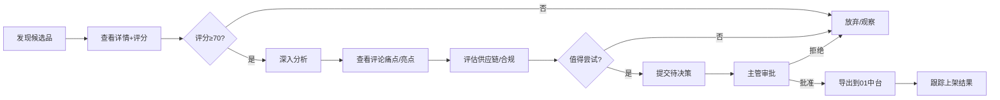

# 03 实战运营手册

> **软件名称**：跨境电商竞品情报采集与选品决策分析系统 V1.0  
> **文档版本**：V1.0  
> **最后更新**：2026-07-19

---

## 1. 角色职责矩阵（RACI）

| 活动 | 选品主管 | 选品专员 | 数据分析师 | 爬虫工程师 | 客成 |
|------|:--------:|:--------:|:----------:|:----------:|:----:|
| 监控清单维护 | A | R | C | I | - |
| 日常选品筛选 | A | R | C | - | - |
| 选品决策审批 | A/R | C | C | - | - |
| 评分模型调优 | A | C | R | - | - |
| 采集任务管理 | C | I | - | A/R | - |
| 日报/预警处理 | A | R | - | I | I |
| 选品复盘 | A | R | R | - | C |
| 导出到 01 中台 | A | R | - | - | - |
| 客户培训 | I | C | - | - | A/R |

---

## 2. 核心 KPI 体系

### 2.1 选品 KPI

| 指标 | 定义 | 目标值 | 统计周期 | 责任人 |
|------|------|--------|----------|--------|
| 选品决策数 | 本月批准选品数 | ≥10 | 月 | 选品主管 |
| 选品成功率 | 上架后 30 天有销量占比 | ≥50% | 月 | 选品主管 |
| 选品 ROI | 选中品平均 ROI | ≥1.5 | 月 | 选品主管 |
| 决策周期 | 从发现到决策平均天数 | ≤3 天 | 周 | 选品专员 |
| 评分模型准确率 | 高分品实际表现优于低分品 | ≥70% | 月 | 数据分析师 |

### 2.2 情报 KPI

| 指标 | 定义 | 目标值 | 统计周期 |
|------|------|--------|----------|
| 采集成功率 | 成功采集/总任务 | ≥95% | 日 |
| 价格数据时效 | 价格变动检测延迟 | ≤6h | 日 |
| 评论数据时效 | 新评论采集延迟 | ≤24h | 日 |
| 日报送达率 | 成功推送/应推送 | 100% | 日 |
| 预警准确率 | 真实变动/总预警 | ≥90% | 周 |

### 2.3 系统 KPI

| 指标 | 目标值 | 告警阈值 |
|------|--------|----------|
| 采集熔断次数 | 0 次/周 | ≥1 次 |
| 系统可用性 | ≥99% | <98% |
| 看板加载时间 | <3s | >5s |

---

## 3. 日 SOP（每日执行）

### 3.1 选品专员 — 每日 09:00–10:30

| 序号 | 动作 | 检查点 | 异常处理 |
|------|------|--------|----------|
| 1 | 查看日报（邮件/企微） | 已阅读 | 未收到 → 检查推送配置 |
| 2 | 处理预警（价格/评论/BSR） | 全部已读 | 重要预警 → 立即分析 |
| 3 | 查看「机会品推荐」 | Top 10 | 筛选 3-5 个深入分析 |
| 4 | 深入分析候选品 | 完成详情页查看 | - |
| 5 | 标注/收藏有价值商品 | 标注数 | - |
| 6 | 提交待决策商品（≥1 个） | 提交数 | - |
| 7 | 填写《日选品日志》 | 完成 | - |

### 3.2 选品主管 — 每日 10:30–11:00

| 序号 | 动作 | 检查点 | 异常处理 |
|------|------|--------|----------|
| 1 | 审批待决策选品 | 当日审完 | 积压 >5 → 优先处理 |
| 2 | 查看采集状态面板 | 成功率 ≥95% | <90% → 通知爬虫工程师 |
| 3 | 查看熔断/异常告警 | 无熔断 | 有 → 按异常手册处理 |
| 4 | 检查监控清单覆盖率 | 清单完整 | 缺失 → 补充 |

### 3.3 爬虫工程师 — 每日 09:00

| 序号 | 动作 | 检查点 | 异常处理 |
|------|------|--------|----------|
| 1 | 查看采集任务队列 | 无积压 | 积压 >500 → 扩容 Worker |
| 2 | 查看采集成功率 | ≥95% | <90% → 排查原因 |
| 3 | 检查代理池状态 | 可用 IP ≥10 | <5 → 补充代理 |
| 4 | 查看熔断记录 | 无新增 | 有 → 分析原因，调整策略 |
| 5 | 检查验证码触发记录 | 无频繁触发 | 频繁 → 降低频率 |

### 3.4 数据分析师 — 每日（按需）

| 序号 | 动作 | 产出 |
|------|------|------|
| 1 | 监控评分分布异常 | 异常报告 |
| 2 | 检查 AI 分析任务完成情况 | 状态确认 |

---

## 4. 周 SOP（每周一执行）

### 4.1 选品周会（每周一 10:00，60 分钟）

| 议程 | 时长 | 产出 |
|------|------|------|
| 上周选品决策回顾 | 15min | 决策清单 |
| 已上架商品表现 | 15min | 表现分析 |
| 竞品动态周报 | 10min | 竞品摘要 |
| 评分模型反馈 | 10min | 调整建议 |
| 本周选品目标 | 5min | 目标清单 |
| 监控清单更新 | 5min | 新增/删除 ASIN |

### 4.2 选品专员 — 每周一

| 序号 | 动作 | 产出 |
|------|------|------|
| 1 | 导出上周选品统计 | 周报数据 |
| 2 | 更新监控清单（新增竞品、删除无效） | 清单更新 |
| 3 | 完成 ≥3 个选品决策 | 决策记录 |
| 4 | 导出批准选品到 01 中台 | 上架任务 |

### 4.3 数据分析师 — 每周三

| 序号 | 动作 | 产出 |
|------|------|------|
| 1 | 分析评分与实际表现相关性 | 相关性报告 |
| 2 | 检查 AI 痛点提炼准确率（抽检 10 个） | 质检报告 |
| 3 | 提出权重调整建议 | 建议文档 |

### 4.4 爬虫工程师 — 每周一

| 序号 | 动作 | 产出 |
|------|------|------|
| 1 | 导出采集统计周报 | 采集周报 |
| 2 | 检查代理池成本与效果 | 代理报告 |
| 3 | 评估采集策略优化点 | 优化建议 |

### 4.5 周报模板

```markdown
## 选品情报系统周报 YYYY-WW

### 核心指标
| 指标 | 本周 | 上周 | 目标 | 状态 |
|------|------|------|------|------|
| 选品决策数 | | | ≥3/周 | |
| 采集成功率 | | | ≥95% | |
| 预警处理率 | | | 100% | |
| 批准选品数 | | | | |

### 本周选品决策
| ASIN | 商品名 | 评分 | 决策 | 理由 |
|------|--------|------|------|------|
| | | | | |

### 竞品动态
-

### 问题与风险
-

### 下周计划
-
```

---

## 5. 月 SOP（每月第一个工作日）

### 5.1 月度复盘会（2 小时）

| 议程 | 产出 |
|------|------|
| 月度选品 KPI 达成 | 月度报告 |
| 选品成功率与 ROI 分析 | 成功/失败案例 |
| 评分模型校准 | 新权重配置 |
| 采集成本与效率 | 成本报告 |
| 下月选品策略 | 策略文档 |

### 5.2 月度必做事项

| 角色 | 事项 | 截止 |
|------|------|------|
| 选品主管 | 月度选品报告 | 每月 3 日 |
| 选品主管 | 选品成功率复盘 | 每月 5 日 |
| 数据分析师 | 评分模型校准 | 每月 10 日 |
| 数据分析师 | AI 分析准确率评估 | 每月 15 日 |
| 爬虫工程师 | 采集策略优化 | 每月 20 日 |
| 爬虫工程师 | 代理池成本审计 | 每月 25 日 |

### 5.3 选品复盘流程

```text
1. 导出本月所有决策记录
2. 关联 01 中台上架结果（销量、ROI）
3. 按评分段分组统计成功率
4. 分析失败案例共性
5. 调整评分权重
6. 更新选品策略文档
```

---

## 6. 异常处理手册

### 6.1 采集熔断（验证码/封 IP）

| 步骤 | 动作 | 责任人 | 时效 |
|------|------|--------|------|
| 1 | 系统自动暂停采集，发送告警 | 自动 | 即时 |
| 2 | 确认影响范围（单 IP/全局） | 爬虫工程师 | 15min |
| 3 | 切换代理 IP | 爬虫工程师 | 30min |
| 4 | 降低采集频率 50% | 爬虫工程师 | 即时 |
| 5 | 观察 2 小时，无异常后恢复 | 爬虫工程师 | 2h |
| 6 | 通知选品团队数据可能延迟 | 选品主管 | 即时 |
| 7 | 复盘，更新采集策略 | 爬虫工程师 | 24h |

**预防措施**：
- 严格遵守限速规则
- 代理池定期轮换
- 避免高峰时段集中采集

### 6.2 评分异常（大量分数突变）

| 步骤 | 动作 | 责任人 |
|------|------|--------|
| 1 | 确认是否为全量重算导致 | 数据分析师 |
| 2 | 检查评分模型/权重是否变更 | 数据分析师 |
| 3 | 检查数据源是否异常（如 BSR 缺失） | 爬虫工程师 |
| 4 | 若为 bug → 回滚并重算 | 数据分析师 |
| 5 | 通知选品团队暂时人工判断 | 选品主管 |

### 6.3 日报未送达

| 步骤 | 动作 | 责任人 |
|------|------|--------|
| 1 | 检查日报生成任务日志 | 爬虫工程师 |
| 2 | 检查推送渠道配置 | 爬虫工程师 |
| 3 | 手动触发日报生成 | 爬虫工程师 |
| 4 | 手动发送日报 | 选品主管 |
| 5 | 修复根本原因 | 爬虫工程师 |

### 6.4 AI 痛点分析错误

| 步骤 | 动作 | 责任人 |
|------|------|--------|
| 1 | 选品专员标记错误分析 | 选品专员 |
| 2 | 汇总错误样本 | 数据分析师 |
| 3 | 分析错误模式 | 数据分析师 |
| 4 | 优化 Prompt 或重跑分析 | 数据分析师 |
| 5 | 更新质检抽检比例 | 选品主管 |

### 6.5 监控 ASIN 失效（下架/变狗）

| 步骤 | 动作 | 责任人 |
|------|------|--------|
| 1 | 系统自动标记并告警 | 自动 |
| 2 | 选品专员确认状态 | 选品专员 |
| 3 | 从监控清单移除或替换 | 选品专员 |
| 4 | 若为竞品下架 → 记录并分析原因 | 选品主管 |

---

## 7. 选品决策 SOP

### 7.1 标准决策流程



### 7.2 决策检查清单

**批准前必须确认**：
- [ ] 综合评分 ≥70
- [ ] 已查看评论痛点/亮点分析
- [ ] 价格区间有利润空间（毛利率 ≥30%）
- [ ] 无合规红线（对接 07 检查）
- [ ] 供应链可行（重量、体积、起订量）
- [ ] 差异化策略明确（如何与竞品区隔）
- [ ] 决策理由已记录

### 7.3 决策记录模板

| 字段 | 内容 |
|------|------|
| ASIN | |
| 商品名 | |
| 综合评分 | |
| 决策 | 批准/拒绝 |
| 核心理由 | |
| 差异化策略 | |
| 定价建议 | |
| 风险提示 | |
| 决策人 | |
| 日期 | |

---

## 8. 客户 Onboarding SOP

### 8.1 标准 Onboarding（3 工作日）

| 天 | 步骤 | 负责 | 验收标准 |
|----|------|------|----------|
| D1 | 账号开通、基础配置 | 客成 | 可登录 |
| D1 | 导入首批监控 ASIN（≥20 个） | 选品专员 | 清单可见 |
| D2 | 校准评分权重（按客户品类） | 数据分析师 | 权重已配置 |
| D2 | 配置日报推送 | 爬虫工程师 | 收到测试日报 |
| D3 | 客户培训（看板操作、决策流程） | 客成 | 客户可独立操作 |
| D3 | 完成 1 个选品决策闭环 | 选品专员 | 决策已记录 |

### 8.2 Onboarding 验收清单

- [ ] 监控清单 ≥20 个 ASIN
- [ ] 评分权重已校准
- [ ] 日报推送正常
- [ ] 预警配置完成
- [ ] 客户培训完成
- [ ] 完成 1 个选品决策

---

## 9. 监控清单管理规范

### 9.1 清单分类

| 类型 | 用途 | 更新频率 |
|------|------|----------|
| 核心竞品 | 直接竞争对手，重点监控 | 每周检查 |
| 机会品库 | 潜在可进入品类 | 每日筛选 |
| 已选品跟踪 | 已批准待上架/已上架 | 持续跟踪 |
| 品类标杆 | 品类 TOP 卖家参考 | 每月更新 |

### 9.2 清单维护规则

- 核心竞品：每个品类 3-5 个 ASIN
- 单客户监控上限：按套餐（标准 100，专业 500，企业无限）
- 失效 ASIN 7 天内清理
- 新增 ASIN 需注明原因

---

## 10. 培训材料清单

| 材料 | 对象 | 时长 |
|------|------|------|
| 产品概览 PPT | 全员 | 30min |
| 看板操作视频 | 客户/选品 | 30min |
| 选品决策流程培训 | 选品团队 | 45min |
| 评分模型解读 | 选品/数据 | 30min |
| 采集异常处理 | 爬虫/选品主管 | 20min |

---

**文档维护人**：选品主管  
**下次审核日期**：2026-10-19
