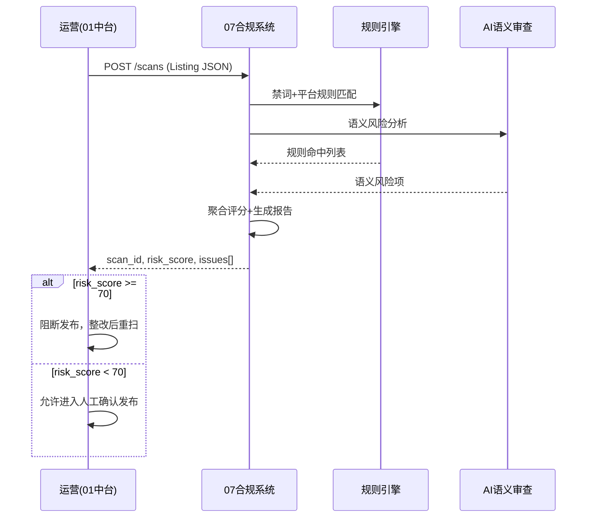

# 01-产品需求规格书

**产品名称**：跨境电商商品信息合规审查与风险预警系统 V1.0  
**文档版本**：V1.0 | 2026-07-19  
**状态**：评审基线

---

## 1. 文档说明

### 1.1 目的
定义合规审查系统的产品范围、用户场景、功能需求、非功能需求及验收标准，作为研发 Sprint 拆分与测试用例编写依据。

### 1.2 术语

| 术语 | 定义 |
|------|------|
| Listing | 平台商品刊登信息（标题、五点、描述、图片、属性等） |
| 禁词 | 平台禁止或高风险词汇（绝对化、医疗声明、品牌词等） |
| 风险分 | 0–100 综合评分，≥70 高风险，40–69 中风险，<40 低风险 |
| 可解释报告 | 列出每条命中规则、字段位置、证据片段、整改建议 |
| 规则版本 | 某平台某站点某类目规则的快照，可回溯 |

---

## 2. 用户画像与场景

### 2.1 用户故事

| ID | 角色 | 故事 | 优先级 |
|----|------|------|--------|
| US-01 | 运营 | 保存 Listing 草稿时自动扫描，30 秒内看到风险点 | P0 |
| US-02 | 运营 | 点击风险项跳转到对应字段并看到替换建议 | P0 |
| US-03 | 合规 | 维护禁词库并按平台/站点/类目生效 | P0 |
| US-04 | 主管 | 查看团队本周合规率与高频违规类型 | P1 |
| US-05 | 技术 | 通过 API 将审查嵌入 01 运营中台发布流 | P0 |
| US-06 | 合规 | 上架后 Listing 变更时自动 diff 复检 | P1 |
| US-07 | 运营 | 批量导入 100 条 SKU 异步审查并导出报告 | P1 |
| US-08 | 法务 | 高风险项标记「需法务确认」并留审计记录 | P1 |

### 2.2 核心场景流程

#### 场景 A：上架前审查（主路径）



#### 场景 B：定时复检

- 每日 02:00 拉取已发布 Listing 快照
- 与上次审查版本 diff
- 规则库升级后对全量重扫
- 新增高风险 → 钉钉告警 + 01 待办

---

## 3. 功能需求

### 3.1 模块总览

| 模块 | 说明 | 优先级 |
|------|------|--------|
| M1 审查引擎 | 文本/图片/属性扫描 | P0 |
| M2 规则中心 | 禁词、平台规则、类目限制 | P0 |
| M3 报告中心 | 可解释报告、导出、历史 | P0 |
| M4 集成中心 | 01/10 Webhook、API | P0 |
| M5 运营看板 | KPI、趋势、团队排名 | P1 |
| M6 审批流 | 高风险法务确认 | P1 |

### 3.2 M1 审查引擎

#### F1.1 文本审查
- 支持字段：title, bullet_points[], description, search_terms, backend_keywords
- 支持语言：en, de, fr, es, ja, zh（V1.0 至少 en + zh）
- 检测类型：
  - 禁词精确/模糊/正则匹配
  - 绝对化用语（best, #1, guaranteed cure 等）
  - 医疗/功效声明
  - 联系方式外链
  - 竞品品牌词误用
- 输出：字段路径、起止偏移、命中规则 ID、严重级别、建议替换

#### F1.2 图片审查（V1.0 基础版）
- OCR 提取图中文字 → 走文本审查
- 基础视觉风险：水印、二维码、联系方式图层（可选模型）
- 商标 Logo 初筛（基于已知品牌库模糊匹配）

#### F1.3 属性与类目审查
- 必填属性完整性
- 类目禁售/需资质校验（如电池、化妆品、医疗器械）
- 变体关系一致性（父 SKU 与子 SKU 声明冲突）

#### F1.4 风险评分算法

```text
risk_score = min(100,
  Σ(issue.severity_weight × issue.confidence) × platform_multiplier
)
```

| 严重级别 | 权重 | 处理策略 |
|----------|------|----------|
| BLOCKER | 40 | 阻断发布 |
| HIGH | 25 | 需主管确认 |
| MEDIUM | 10 | 警告，可继续 |
| LOW | 3 | 提示 |

#### F1.5 审查模式

| 模式 | 说明 |
|------|------|
| SYNC | 单条实时，≤30s |
| ASYNC | 批量队列，支持 1000 条/任务 |
| DIFF | 仅扫描变更字段 |
| SCHEDULED | 定时全量/增量 |

### 3.3 M2 规则中心

#### F2.1 禁词库管理
- 维度：平台、站点、语言、类目、租户自定义
- 操作：单条增删改、CSV 导入、批量启用/停用
- 匹配模式：精确、词干、正则、同义词扩展
- 版本：每次发布生成 `rule_set_version`，审查记录绑定版本

#### F2.2 平台规则库
- 预置：Amazon US/EU、TikTok Shop US、Shopify 通用
- 结构：规则 ID、描述、适用类目、检测逻辑引用、官方文档链接
- 更新：运营上传 JSON 补丁 → 合规审核 → 发布

#### F2.3 侵权初筛库
- 商标词库（租户可导入 Watch List）
- 专利关键词（文本描述匹配，非法律检索）
- 命中后标注「初筛，非法律意见」

### 3.4 M3 报告中心

#### F3.1 报告内容
- 摘要：风险分、级别、是否可发布、规则版本
- 明细表：序号、字段、原文片段、规则名、级别、建议
- 整改清单：可复制替换文案
- 审计：审查人、时间、模型版本

#### F3.2 导出格式
- HTML（在线查看）、PDF、JSON（API 消费）

### 3.5 M4 集成中心

#### F4.1 与 01 运营中台
- 事件：`listing.draft.saved` → 触发审查
- 回调：`compliance.scan.completed` → 回写 risk_score
- 发布闸口：01 配置 `min_risk_score_to_publish = 70`

#### F4.2 与 10 Agent 中枢
- 工具名：`compliance.scan_listing`
- 工具名：`compliance.get_report`
- 工具名：`compliance.check_keywords`

### 3.6 M5 运营看板

- 今日/本周审查量、拦截率、误报申诉率
- Top 10 违规规则
- 按运营人员合规率排名（脱敏可配置）
- 平台/站点分布

### 3.7 M6 审批流

- 触发：存在 BLOCKER 或法务标记规则
- 状态：待法务 → 已通过/已驳回
- 驳回必须填写意见并回写 01 待办

---

## 4. 非功能需求

| 类别 | 要求 |
|------|------|
| 性能 | 单条文本审查 P95 ≤ 30s；批量 100 条 ≤ 10min |
| 可用性 | 99.5% 月度可用（SaaS） |
| 安全 | 租户隔离；敏感词库加密；审计日志 180 天 |
| 合规 | 客户数据不用于公共模型训练 |
| 扩展 | 新平台规则插件化加载 |
| 国际化 | 控制台中文；报告支持 en/zh |

---

## 5. 角色与权限（RBAC）

| 权限 | 运营 | 合规 | 主管 | 管理员 |
|------|------|------|------|--------|
| 发起审查 | ✓ | ✓ | ✓ | ✓ |
| 查看报告 | ✓(本店) | ✓ | ✓(团队) | ✓ |
| 编辑禁词 | - | ✓ | ✓ | ✓ |
| 发布规则版本 | - | ✓ | - | ✓ |
| 法务审批 | - | ✓ | ✓ | ✓ |
| 租户配置 | - | - | - | ✓ |

---

## 6. 验收标准

### 6.1 功能验收

| 编号 | 验收项 | 通过标准 |
|------|--------|----------|
| AC-01 | 禁词拦截 | 预置 100 条测试用例，召回率 ≥ 95% |
| AC-02 | 误报控制 | 标准样本集误报率 ≤ 15% |
| AC-03 | 可解释性 | 每条 issue 含字段路径+原文+规则+建议 |
| AC-04 | 01 集成 | 草稿保存自动审查，高风险阻断发布 |
| AC-05 | 批量审查 | 100 条异步任务成功完成并汇总 |
| AC-06 | 报告导出 | PDF/HTML 与线上一致 |
| AC-07 | 规则版本 | 可回溯任意历史审查所用规则版本 |
| AC-08 | 审计日志 | 所有规则变更、审批可追溯 |

### 6.2 测试数据集要求

- 至少 3 个平台各 50 条真实脱敏 Listing
- 含 20 条故意埋入的高风险样本
- 含 10 条边界样本（易误报）

### 6.3 上线 Gate

- [ ] 合规顾问签字确认规则库 V1.0
- [ ] 与 01 联调通过
- [ ] 生产环境压测通过
- [ ] 运营培训完成（见 03 文档）

---

## 7. 版本范围（V1.0 vs 后续）

| 功能 | V1.0 | V1.5+ |
|------|------|-------|
| 文本审查 | ✓ | 多语言增强 |
| 图片 OCR 审查 | 基础 | 视觉侵权模型 |
| Amazon + TikTok 规则 | ✓ | Walmart、eBay |
| 定时复检 | ✓ | 实时竞品监控联动 |
| 自定义规则 DSL | - | ✓ |

---

## 8. 依赖与风险

| 依赖 | 说明 |
|------|------|
| 01 运营中台 | Listing 数据结构与 Webhook |
| LLM Gateway | 语义审查模型调用 |
| 合规顾问 | 规则库初始内容与持续更新 |

| 风险 | 缓解 |
|------|------|
| 规则过时 | 双周规则评审会 + 版本告警 |
| AI 幻觉 | 规则引擎为主，AI 为辅；低置信度降级为提示 |
| 误报引发运营抵触 | 申诉通道 + 白名单机制 |

---

**审批**：产品 __________ | 研发 __________ | 合规顾问 __________
