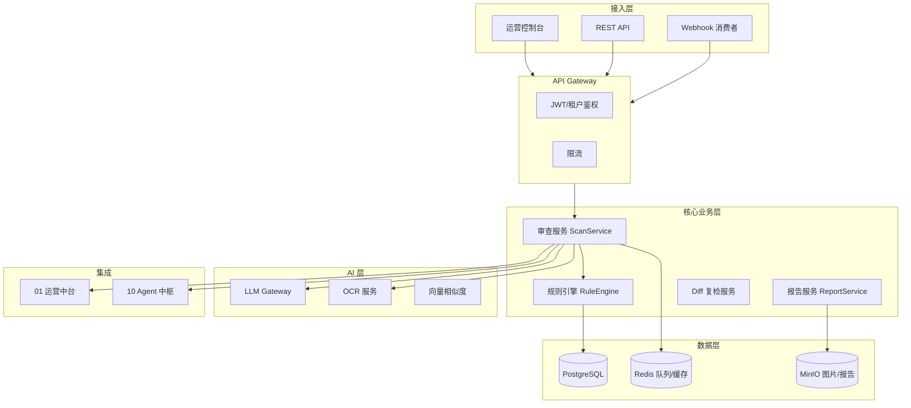
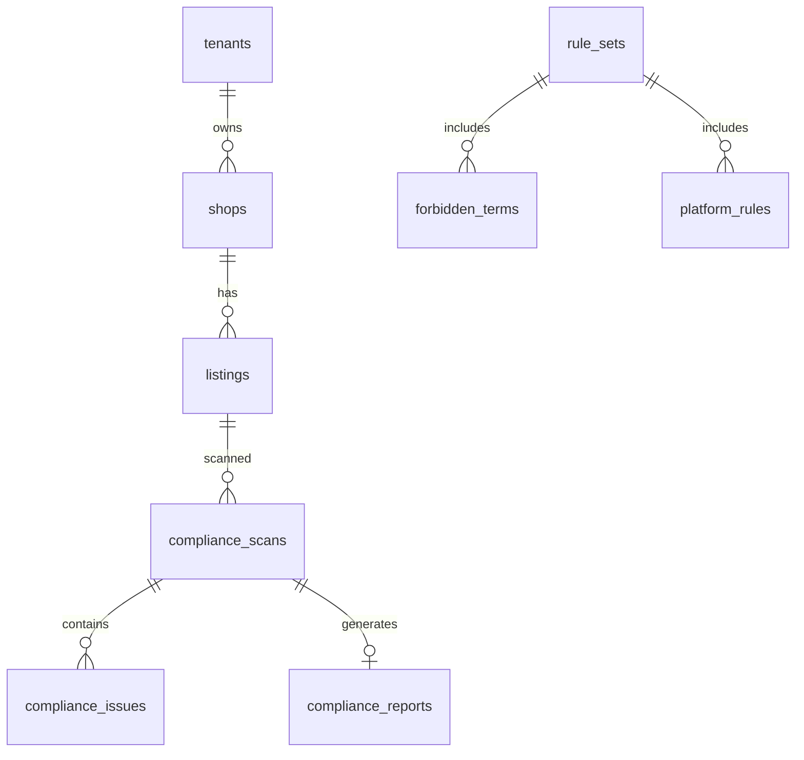

# 02-技术架构与数据设计

**产品**：跨境电商商品信息合规审查与风险预警系统 V1.0  
**文档版本**：V1.0 | 2026-07-19

---

## 1. 系统架构

### 1.1 逻辑架构



### 1.2 审查流水线

```text
Input Listing JSON
    → 字段解析器 (FieldParser)
    → 并行执行:
        ├─ 禁词匹配器 (Aho-Corasick + 正则)
        ├─ 平台规则检查器 (RuleChecker)
        ├─ 类目资质检查器 (CategoryChecker)
        └─ LLM 语义审查 (SemanticReviewer)
    → 结果聚合器 (IssueAggregator)
    → 评分器 (RiskScorer)
    → 报告生成器 (ReportBuilder)
    → 持久化 + 回调
```

### 1.3 技术选型

| 层 | 选型 | 说明 |
|----|------|------|
| 后端 | NestJS (TypeScript) | 与 01 中台技术栈统一 |
| 规则引擎 | 自研 + json-rules-engine | 平台规则可配置 |
| 禁词匹配 | ahocorasick + flexsearch | 毫秒级多模式匹配 |
| 队列 | BullMQ + Redis | 批量/async 审查 |
| 数据库 | PostgreSQL 15 | JSONB 存 Listing 快照 |
| OCR | PaddleOCR / 云 API | 图片文字提取 |
| LLM | 统一 LLM Gateway | GPT-4o-mini / DeepSeek 可切换 |
| 部署 | Docker Compose / K8s | 见 §6 |

---

## 2. 核心模块

### 2.1 ScanService（审查服务）

```typescript
interface ScanRequest {
  tenant_id: string;
  shop_id: string;
  platform: 'amazon' | 'tiktok' | 'shopify';
  marketplace: string;        // e.g. US, DE
  category_id?: string;
  listing: ListingPayload;
  mode: 'sync' | 'async';
  rule_set_version?: string;  // 指定版本，默认 latest
  callback_url?: string;
}

interface ScanResult {
  scan_id: string;
  risk_score: number;
  risk_level: 'low' | 'medium' | 'high' | 'blocker';
  publishable: boolean;
  issues: ComplianceIssue[];
  rule_set_version: string;
  report_url: string;
}
```

### 2.2 RuleEngine（规则引擎）

- **禁词规则**：`ForbiddenTermRule`
- **平台规则**：`PlatformPolicyRule`（JSON 条件表达式）
- **类目规则**：`CategoryRestrictionRule`
- **租户自定义**：`CustomRule`（V1.5 DSL）

规则加载：内存缓存 + Redis Pub/Sub 热更新

### 2.3 SemanticReviewer（AI 语义审查）

- 输入：字段文本 + 平台上下文
- 输出：结构化 JSON issues（非自由文本）
- 低温度 (0.1) + JSON Schema 约束
- 与规则引擎结果去重合并

### 2.4 ReportService

- 模板引擎：Handlebars → HTML → Puppeteer PDF
- 报告存储：`s3://{tenant}/reports/{scan_id}.pdf`

---

## 3. 数据库设计（字段级）

### 3.1 ER 关系



### 3.2 表：compliance_scans

| 字段 | 类型 | 约束 | 说明 |
|------|------|------|------|
| id | UUID | PK | scan_id |
| tenant_id | UUID | NOT NULL, IDX | 租户 |
| shop_id | UUID | NOT NULL, IDX | 店铺 |
| listing_id | UUID | IDX | 关联 01 listing |
| platform | VARCHAR(32) | NOT NULL | 平台 |
| marketplace | VARCHAR(8) | NOT NULL | 站点 |
| listing_snapshot | JSONB | NOT NULL | 审查时 Listing 全文 |
| listing_hash | VARCHAR(64) | IDX | 内容哈希，去重 |
| mode | VARCHAR(16) | NOT NULL | sync/async/diff |
| status | VARCHAR(16) | NOT NULL | pending/running/completed/failed |
| risk_score | SMALLINT | | 0-100 |
| risk_level | VARCHAR(16) | | low/medium/high/blocker |
| publishable | BOOLEAN | | 是否建议可发布 |
| rule_set_version | VARCHAR(32) | NOT NULL | 规则版本 |
| issue_count | INT | DEFAULT 0 | 问题数 |
| scan_duration_ms | INT | | 耗时 |
| triggered_by | VARCHAR(64) | | user_id / webhook / agent |
| parent_scan_id | UUID | FK | diff 模式的上次 scan |
| callback_url | TEXT | | 完成回调 |
| created_at | TIMESTAMPTZ | NOT NULL | |
| completed_at | TIMESTAMPTZ | | |

### 3.3 表：compliance_issues

| 字段 | 类型 | 约束 | 说明 |
|------|------|------|------|
| id | UUID | PK | |
| scan_id | UUID | FK, IDX | |
| rule_id | VARCHAR(64) | NOT NULL | 规则标识 |
| rule_name | VARCHAR(256) | NOT NULL | 展示名 |
| rule_source | VARCHAR(32) | | forbidden/platform/ai/custom |
| field_path | VARCHAR(128) | NOT NULL | 如 bullet_points[2] |
| start_offset | INT | | 字符偏移 |
| end_offset | INT | | |
| matched_text | TEXT | NOT NULL | 命中片段 |
| severity | VARCHAR(16) | NOT NULL | BLOCKER/HIGH/MEDIUM/LOW |
| confidence | DECIMAL(3,2) | | 0.00-1.00 |
| suggestion | TEXT | | 替换建议 |
| explanation | TEXT | | 可解释说明 |
| legal_review_required | BOOLEAN | DEFAULT false | 需法务 |
| created_at | TIMESTAMPTZ | NOT NULL | |

### 3.4 表：forbidden_terms

| 字段 | 类型 | 约束 | 说明 |
|------|------|------|------|
| id | UUID | PK | |
| rule_set_id | UUID | FK, IDX | |
| tenant_id | UUID | IDX | NULL=平台级 |
| platform | VARCHAR(32) | | 空=全平台 |
| marketplace | VARCHAR(8) | | |
| language | VARCHAR(8) | NOT NULL | en/de/... |
| term | VARCHAR(512) | NOT NULL | |
| match_mode | VARCHAR(16) | | exact/fuzzy/regex |
| severity | VARCHAR(16) | NOT NULL | |
| category_ids | TEXT[] | | 适用类目 |
| replacement_hint | VARCHAR(512) | | 建议替换 |
| is_active | BOOLEAN | DEFAULT true | |
| created_by | UUID | | |
| updated_at | TIMESTAMPTZ | | |

### 3.5 表：rule_sets

| 字段 | 类型 | 约束 | 说明 |
|------|------|------|------|
| id | UUID | PK | |
| version | VARCHAR(32) | UNIQUE | 如 v2026.07.1 |
| platform | VARCHAR(32) | | |
| description | TEXT | | |
| status | VARCHAR(16) | | draft/published/archived |
| published_at | TIMESTAMPTZ | | |
| published_by | UUID | | |

### 3.6 表：legal_approvals

| 字段 | 类型 | 约束 | 说明 |
|------|------|------|------|
| id | UUID | PK | |
| scan_id | UUID | FK | |
| status | VARCHAR(16) | | pending/approved/rejected |
| reviewer_id | UUID | | |
| comment | TEXT | | |
| created_at | TIMESTAMPTZ | | |
| resolved_at | TIMESTAMPTZ | | |

---

## 4. 核心 API

### 4.1 审查 API

#### POST /api/v1/scans

创建审查任务。

```json
// Request
{
  "shop_id": "uuid",
  "platform": "amazon",
  "marketplace": "US",
  "listing": {
    "title": "Premium Kitchen Knife Set",
    "bullet_points": ["Best knife in the world", "..."],
    "description": "...",
    "images": ["https://..."]
  },
  "mode": "sync"
}

// Response 200
{
  "scan_id": "uuid",
  "risk_score": 78,
  "risk_level": "high",
  "publishable": false,
  "issues": [
    {
      "field_path": "bullet_points[0]",
      "matched_text": "Best knife in the world",
      "severity": "HIGH",
      "rule_name": "Amazon绝对化用语",
      "suggestion": "High-quality kitchen knife set for daily use"
    }
  ],
  "report_url": "/api/v1/scans/uuid/report"
}
```

#### GET /api/v1/scans/{scan_id}

查询审查详情与 issues 列表。

#### POST /api/v1/scans/batch

批量异步审查，返回 `batch_id`。

#### GET /api/v1/scans/{scan_id}/report?format=pdf|html|json

下载报告。

### 4.2 规则 API

| 方法 | 路径 | 说明 |
|------|------|------|
| GET | /api/v1/rule-sets | 规则版本列表 |
| POST | /api/v1/rule-sets/{version}/publish | 发布规则 |
| GET | /api/v1/forbidden-terms | 分页查询禁词 |
| POST | /api/v1/forbidden-terms/import | CSV 导入 |
| POST | /api/v1/keywords/check | 快速禁词检测（供 10 调用） |

### 4.3 Webhook

#### 出站（本系统 → 01/10）

```json
{
  "event": "compliance.scan.completed",
  "scan_id": "uuid",
  "listing_id": "uuid",
  "risk_score": 45,
  "publishable": true,
  "timestamp": "2026-07-19T10:00:00Z"
}
```

#### 入站（01 → 本系统）

- `listing.draft.saved` → 自动创建 scan
- `listing.published` → 存档基准快照

### 4.4 Agent 工具接口（10 号）

```yaml
tools:
  - name: compliance.scan_listing
    endpoint: POST /api/v1/scans
  - name: compliance.get_report
    endpoint: GET /api/v1/scans/{id}/report
  - name: compliance.check_keywords
    endpoint: POST /api/v1/keywords/check
```

---

## 5. AI Prompt 模板

### 5.1 语义合规审查 Prompt

```text
你是跨境电商 Listing 合规审查专家。请分析以下商品信息是否符合 {platform} {marketplace} 平台政策。

## 审查维度
1. 绝对化/夸大宣传（best, #1, cure, miracle 等）
2. 医疗/功效声明（未经批准的 health claims）
3. 误导性对比与虚假承诺
4. 敏感品类违规表述（化妆品、食品、儿童用品）
5. 联系方式/站外引流

## 输入
平台: {platform}
站点: {marketplace}
类目: {category_name}
字段: {field_name}
内容:
"""
{field_content}
"""

## 输出要求
仅输出 JSON，不要其他文字：
{
  "issues": [
    {
      "severity": "HIGH|MEDIUM|LOW",
      "matched_text": "原文片段",
      "explanation": "违反的政策说明（中文）",
      "suggestion": "建议修改后的英文文案",
      "confidence": 0.0-1.0
    }
  ]
}
若无问题，返回 {"issues": []}
```

### 5.2 整改文案生成 Prompt

```text
你是 Listing 优化师。以下片段被合规系统标记为高风险，请给出 2 个合规替换方案。

原文（{field_name}）: {matched_text}
违规原因: {explanation}
平台: {platform} {marketplace}
商品品类: {category}

要求:
- 保留核心卖点，去除违规表述
- 语气自然，适合美国消费者
- 每个方案不超过原文字符数的 120%

输出 JSON:
{"alternatives": ["方案A", "方案B"]}
```

### 5.3 图片 OCR 后审查

将 OCR 文本拼接后套用 5.1 Prompt，`field_name` 设为 `image_ocr[{image_index}]`。

---

## 6. 部署方案

### 6.1 Docker Compose（中小客户）

```yaml
# docker-compose.yml 摘要
services:
  compliance-api:
    image: compliance-guard/api:1.0
    ports: ["8007:8000"]
    environment:
      DATABASE_URL: postgres://...
      REDIS_URL: redis://redis:6379
      LLM_GATEWAY_URL: http://llm-gateway:8080
    depends_on: [postgres, redis]

  compliance-worker:
    image: compliance-guard/worker:1.0
    deploy:
      replicas: 2

  postgres:
    image: postgres:15
  redis:
    image: redis:7
  minio:
    image: minio/minio
```

### 6.2 资源建议

| 规模 | API | Worker | DB |
|------|-----|--------|-----|
| 试用 | 1C2G ×1 | 1C2G ×1 | 1C2G |
| 标准 | 2C4G ×2 | 2C4G ×2 | 2C4G |
| 企业 | K8s HPA 2-10 | 独立队列 | RDS 高可用 |

### 6.3 环境变量

| 变量 | 说明 |
|------|------|
| DATABASE_URL | PostgreSQL 连接串 |
| REDIS_URL | 队列 |
| LLM_GATEWAY_URL | AI 网关 |
| S3_ENDPOINT / S3_BUCKET | 报告存储 |
| OPS_WEBHOOK_SECRET | 01 回调签名 |
| JWT_SECRET | API 鉴权 |

### 6.4 监控告警

- Prometheus 指标：`scan_duration_seconds`, `scan_issues_total`, `rule_cache_hit_rate`
- 告警：P95 耗时 > 60s、失败率 > 5%、队列积压 > 500

---

## 7. 安全设计

- 租户行级隔离（RLS 或 tenant_id 强制过滤）
- Listing 快照加密 at-rest（可选 KMS）
- API Key + JWT 双模式
- Webhook HMAC-SHA256 签名

---

**维护**：后端架构组 | 下次评审：规则 DSL V1.5 立项时
