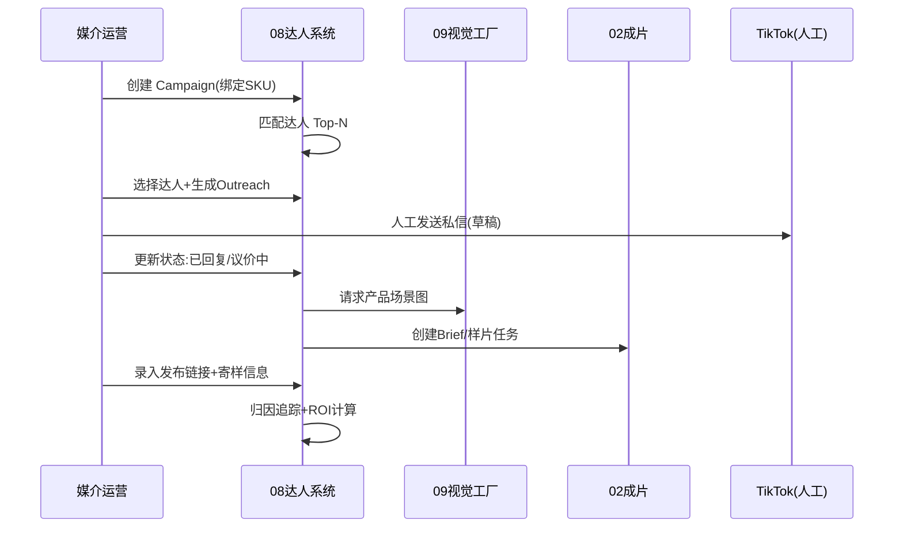

# 01-产品需求规格书

**产品名称**：TikTok达人合作匹配与营销协同管理系统 V1.0  
**文档版本**：V1.0 | 2026-07-19  
**参考实现**：tiktok-creator-sop-tool（字段与状态机参考，须自研匹配与 ROI）

---

## 1. 文档说明

### 1.1 目的
规范 TikTok 达人合作全流程的产品需求，覆盖达人库、智能匹配、Outreach、合作 SOP、ROI 复盘及与兄弟系统集成。

### 1.2 术语

| 术语 | 定义 |
|------|------|
| Creator | TikTok 达人/KOL |
| Outreach | 首次触达（私信/邮件/表单） |
| Deal | 一次完整合作交易（邀约至结算） |
| SOP 阶段 | 合作状态机中的标准节点 |
| ROAS | 广告投资回报率 = 归因 GMV / 合作总成本 |
| Brief | 给达人的拍摄/内容要求文档 |

---

## 2. 用户画像与场景

### 2.1 用户故事

| ID | 角色 | 故事 | 优先级 |
|----|------|------|--------|
| US-01 | 达人运营 | 输入 SKU 后系统推荐 Top 20 匹配达人 | P0 |
| US-02 | 达人运营 | 一键生成个性化 Outreach 私信草稿 | P0 |
| US-03 | 达人运营 | 看板显示今日需跟进的合作及逾期项 | P0 |
| US-04 | 媒介主管 | 审批超过 $500 的合作佣金方案 | P1 |
| US-05 | 内容运营 | 上传 Brief 并关联 02 样片链接 | P1 |
| US-06 | 财务 | 导出本月待结算合作单 | P1 |
| US-07 | 老板 | 查看 Campaign ROAS 与达人排行 | P1 |
| US-08 | Agent | 10 号中枢自动创建达人合作任务 | P1 |

### 2.2 核心场景：新品 TikTok Campaign



---

## 3. 功能需求

### 3.1 模块总览

| 模块 | 说明 | 优先级 |
|------|------|--------|
| M1 达人库 | 档案、标签、导入去重 | P0 |
| M2 匹配引擎 | 多维度评分排序 | P0 |
| M3 Outreach | 模板、草稿、跟进 | P0 |
| M4 合作 SOP | 状态机、任务、提醒 | P0 |
| M5 ROI 中心 | 归因、报表 | P1 |
| M6 集成中心 | 01/02/09/10 | P0 |

### 3.2 M1 达人库

#### F1.1 达人档案字段

| 字段组 | 字段 |
|--------|------|
| 基础 | handle, platform_id, display_name, avatar_url, country, language |
| 规模 | followers, avg_views_30d, engagement_rate, follower_growth_30d |
| 内容 | niches[], content_style[], live_capable, shop_capable |
| 商业 | email, agency, historical_rate_min, historical_rate_max, currency |
| 合作 | cooperation_count, avg_roi, reliability_score, blacklist_flag |
| 标签 | 自定义 tags[], source(import/manual/api) |

#### F1.2 导入与去重
- CSV/Excel 导入，模板下载
- 去重键：platform + handle
- 合并策略：保留最新粉丝数，合并标签

#### F1.3 黑名单
- 原因：违约、数据造假、负面舆情
- 黑名单达人不出现在匹配结果

### 3.3 M2 匹配引擎

#### F2.1 输入
- SKU ID（来自 01）或手动填写：品类、价格带、目标市场、内容调性

#### F2.2 评分维度（可配置权重）

| 维度 | 权重默认 | 说明 |
|------|----------|------|
| 品类契合 | 30% | 达人历史内容与 SKU 品类相似度 |
| 受众匹配 | 25% | 粉丝地域/年龄与目标市场 |
| 互动质量 | 20% | ER、完播率（有则计） |
| 商业表现 | 15% | 历史合作 ROI、履约率 |
| 性价比 | 10% | 报价/粉丝数比 |

#### F2.3 输出
- Top N 列表（默认 20）
- 每条：总分、分项、AI 推荐理由（3 句话）
- 支持「相似达人」扩展

### 3.4 M3 Outreach

#### F3.1 模板管理
- 变量：`{creator_name}`, `{product_name}`, `{selling_point}`, `{commission}`, `{deadline}`
- 多语言：en, es, id, th, vi（按市场）

#### F3.2 草稿生成
- AI 基于达人近期视频风格个性化开头
- **不自动发送**：生成草稿 → 运营复制到 TikTok 私信

#### F3.3 跟进记录
- 时间线：发送、已读（手动标记）、回复、议价笔记
- 下次跟进日期 + 钉钉提醒

### 3.5 M4 合作 SOP

#### F4.1 标准阶段

```text
线索(Lead) → 已触达(Contacted) → 有意向(Interested) → 议价中(Negotiating)
    → 已签约(Signed) → 寄样中(Sample_Shipped) → 内容制作中(In_Production)
    → 待发布(Ready) → 已发布(Published) → 数据回收中(Tracking)
    → 已结算(Closed) / 已取消(Cancelled) / 违约(Disputed)
```

#### F4.2 每阶段必填项

| 阶段 | 必填 |
|------|------|
| Signed | 合作形式、佣金、交付日期、合同附件(可选) |
| Sample_Shipped | 物流单号、SKU 变体 |
| Published | 视频 URL、发布时间 |
| Closed | 实际佣金、归因 GMV |

#### F4.3 逾期规则
- 签约后 7 天未寄样 → 黄色预警
- 寄样后 14 天未发布 → 红色预警
- 可配置 SLA

### 3.6 M5 ROI 中心

#### F5.1 成本项
- 固定费 + 佣金 + 寄样成本 + 广告助推（可选）

#### F5.2 收入归因
- 专属折扣码、联盟链接、TikTok Shop 归因（API/手动录入）
- 曝光、点击、加购、GMV、订单数

#### F5.3 报表
- Campaign / SKU / 达人维度 ROAS
- 漏斗：触达→回复→签约→发布→转化

### 3.7 M6 集成中心

| 系统 | 能力 |
|------|------|
| 01 | 拉取 SKU、库存、价格、佣金政策 |
| 02 | 创建 Brief 任务、回传样片 URL |
| 09 | 拉取产品主图/场景图 |
| 10 | `creator.match`, `creator.create_deal`, `creator.outreach_draft` |

---

## 4. 非功能需求

| 类别 | 要求 |
|------|------|
| 性能 | 匹配 Top 20 ≤ 10s |
| 合规 | 禁止批量自动私信；Outreach 频率提示 |
| 多租户 | 达人库店铺隔离，可选共享池（企业版） |
| 数据 | 达人联系方式加密存储 |

---

## 5. 角色与权限

| 权限 | 达人运营 | 主管 | 财务 | 管理员 |
|------|----------|------|------|--------|
| 达人库编辑 | ✓ | ✓ | - | ✓ |
| 创建合作 | ✓ | ✓ | - | ✓ |
| 审批高价合作 | - | ✓ | - | ✓ |
| 查看 ROI | ✓(本组) | ✓ | ✓ | ✓ |
| 结算确认 | - | ✓ | ✓ | ✓ |

---

## 6. 验收标准

| 编号 | 验收项 | 通过标准 |
|------|--------|----------|
| AC-01 | 达人导入 | 1000 条导入去重正确 |
| AC-02 | 匹配 | 给定 SKU 返回 20 条有分项评分的列表 |
| AC-03 | Outreach | 生成含达人个性化的 en 草稿 |
| AC-04 | SOP | 阶段流转完整，逾期提醒触发 |
| AC-05 | ROI | 录入发布链接后可计算 ROAS |
| AC-06 | 01 集成 | SKU 信息自动填充 |
| AC-07 | 10 集成 | Agent 可创建 Deal 并查询状态 |

---

## 7. V1.0 范围裁剪

| 包含 | 不包含 |
|------|--------|
| 手动录入 + CSV 达人 | TikTok 官方 API 全量同步 |
| 私信草稿（人工发送） | 自动批量私信 |
| 折扣码归因 | 完整 MMM 归因模型 |

---

**审批**：产品 __________ | 研发 __________ | 运营顾问 __________
