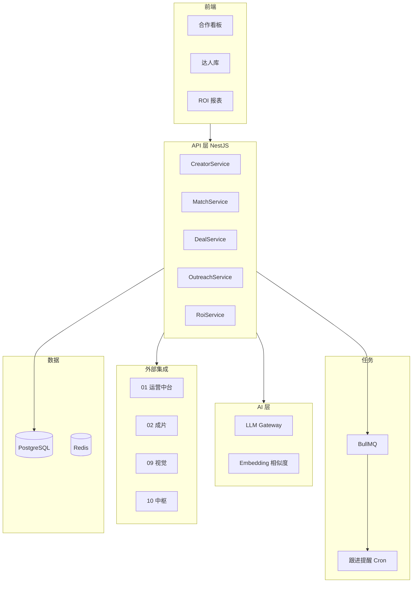

# 02-技术架构与数据设计

**产品**：TikTok达人合作匹配与营销协同管理系统 V1.0  
**文档版本**：V1.0 | 2026-07-19

---

## 1. 系统架构



### 1.1 参考 tiktok-creator-sop-tool 的改造点

| 参考项 | 开源常见实现 | 本系统自研 |
|--------|--------------|------------|
| 达人模型 | 基础 handle/followers | 扩展商业字段、reliability_score |
| 状态机 | 简单 5 态 | 12 态 SOP + SLA 逾期 |
| Outreach | 静态模板 | AI 个性化 + 多语言 |
| 匹配 | 手动筛选 | 多维评分 + Embedding |
| ROI | 无 | 归因引擎 + 报表 |

---

## 2. 核心模块

### 2.1 MatchService

```typescript
interface MatchRequest {
  tenant_id: string;
+ shop_id: string;
  sku_id?: string;
  product_context?: {
    category: string;
    price_usd: number;
    target_market: string;
    selling_points: string[];
  };
  filters?: {
    min_followers?: number;
    max_followers?: number;
    countries?: string[];
    exclude_blacklist?: boolean;
  };
  limit?: number; // default 20
}

interface MatchResult {
  creator_id: string;
  total_score: number;
  breakdown: {
    niche_fit: number;
    audience_fit: number;
    engagement: number;
    commercial: number;
    value: number;
  };
  ai_reason: string;
}
```

**算法流程**：
1. 硬过滤：黑名单、粉丝区间、国家
2. 品类 Embedding：SKU 描述 vs 达人 bio + 近期视频标题
3. 加权打分
4. LLM 生成推荐理由（Top 20）

### 2.2 DealService（合作 SOP）

- 状态机：XState 或 DB 驱动 FSM
- 每次状态变更写 `deal_events` 审计
- SLA Cron 扫描逾期

### 2.3 OutreachService

- 模板渲染 → LLM 个性化 → 存草稿
- **不调用 TikTok 发送 API**（合规）

### 2.4 RoiService

```text
total_cost = fixed_fee + commission_paid + sample_cost + boost_cost
attributed_gmv = sum(orders where attribution matched)
ROAS = attributed_gmv / total_cost
```

---

## 3. 数据库设计（字段级）

### 3.1 表：creators

| 字段 | 类型 | 约束 | 说明 |
|------|------|------|------|
| id | UUID | PK | |
| tenant_id | UUID | NOT NULL, IDX | |
| platform | VARCHAR(16) | DEFAULT 'tiktok' | |
| handle | VARCHAR(128) | NOT NULL | @username |
| platform_id | VARCHAR(64) | IDX | TikTok uid |
| display_name | VARCHAR(256) | | |
| avatar_url | TEXT | | |
| country | CHAR(2) | | ISO |
| language | VARCHAR(8) | | |
| email | VARCHAR(256) | 加密 | |
| followers | INT | | |
| avg_views_30d | INT | | |
| engagement_rate | DECIMAL(5,4) | | |
| follower_growth_30d | DECIMAL(5,4) | | |
| niches | TEXT[] | | 品类标签 |
| content_style | TEXT[] | | |
| live_capable | BOOLEAN | | |
| shop_capable | BOOLEAN | | |
| agency | VARCHAR(256) | | |
| rate_min | DECIMAL(10,2) | | |
| rate_max | DECIMAL(10,2) | | |
| currency | CHAR(3) | DEFAULT 'USD' | |
| cooperation_count | INT | DEFAULT 0 | |
| avg_roi | DECIMAL(8,2) | | |
| reliability_score | SMALLINT | | 0-100 |
| blacklist_flag | BOOLEAN | DEFAULT false | |
| blacklist_reason | TEXT | | |
| tags | TEXT[] | | |
| bio_embedding | VECTOR(1536) | | pgvector |
| source | VARCHAR(32) | | import/manual/api |
| last_synced_at | TIMESTAMPTZ | | |
| created_at | TIMESTAMPTZ | | |
| updated_at | TIMESTAMPTZ | | |

**唯一约束**：`UNIQUE(tenant_id, platform, handle)`

### 3.2 表：campaigns

| 字段 | 类型 | 说明 |
|------|------|------|
| id | UUID | PK |
| tenant_id | UUID | |
| shop_id | UUID | |
| name | VARCHAR(256) | Campaign 名称 |
| sku_ids | UUID[] | 推广 SKU |
| budget_usd | DECIMAL(12,2) | 总预算 |
| target_roas | DECIMAL(6,2) | 目标 ROAS |
| start_date | DATE | |
| end_date | DATE | |
| status | VARCHAR(16) | draft/active/paused/closed |
| owner_id | UUID | 负责人 |
| created_at | TIMESTAMPTZ | |

### 3.3 表：deals

| 字段 | 类型 | 说明 |
|------|------|------|
| id | UUID | PK |
| tenant_id | UUID | |
| campaign_id | UUID | FK |
| creator_id | UUID | FK |
| sku_id | UUID | |
| stage | VARCHAR(32) | SOP 阶段枚举 |
| deal_type | VARCHAR(32) | fixed/commission/hybrid/gifting |
| fixed_fee | DECIMAL(10,2) | |
| commission_rate | DECIMAL(5,4) | |
| currency | CHAR(3) | |
| deliverable_count | INT | 需交付视频数 |
| due_date | DATE | 约定发布日 |
| contract_url | TEXT | |
| sample_tracking_no | VARCHAR(128) | |
| published_urls | TEXT[] | |
| published_at | TIMESTAMPTZ | |
| attributed_gmv | DECIMAL(12,2) | |
| total_cost | DECIMAL(12,2) | |
| roas | DECIMAL(8,2) | |
| next_followup_at | DATE | |
| owner_id | UUID | |
| created_at | TIMESTAMPTZ | |
| updated_at | TIMESTAMPTZ | |

### 3.4 表：deal_events

| 字段 | 类型 | 说明 |
|------|------|------|
| id | UUID | PK |
| deal_id | UUID | FK, IDX |
| from_stage | VARCHAR(32) | |
| to_stage | VARCHAR(32) | |
| event_type | VARCHAR(32) | stage_change/note/reminder |
| payload | JSONB | |
| operator_id | UUID | |
| created_at | TIMESTAMPTZ | |

### 3.5 表：outreach_messages

| 字段 | 类型 | 说明 |
|------|------|------|
| id | UUID | PK |
| deal_id | UUID | FK |
| creator_id | UUID | FK |
| channel | VARCHAR(16) | dm/email/other |
| template_id | UUID | |
| subject | VARCHAR(512) | 邮件用 |
| body | TEXT | 草稿正文 |
| language | VARCHAR(8) | |
| status | VARCHAR(16) | draft/sent/replied/no_reply |
| sent_at | TIMESTAMPTZ | 人工标记 |
| replied_at | TIMESTAMPTZ | |
| created_at | TIMESTAMPTZ | |

### 3.6 表：attribution_records

| 字段 | 类型 | 说明 |
|------|------|------|
| id | UUID | PK |
| deal_id | UUID | FK |
| source | VARCHAR(32) | discount_code/affiliate_link/manual |
| code_or_link | VARCHAR(256) | |
| impressions | INT | |
| clicks | INT | |
| orders | INT | |
| gmv | DECIMAL(12,2) | |
| recorded_at | DATE | |
| created_at | TIMESTAMPTZ | |

### 3.7 表：outreach_templates

| 字段 | 类型 | 说明 |
|------|------|------|
| id | UUID | PK |
| tenant_id | UUID | |
| name | VARCHAR(128) | |
| language | VARCHAR(8) | |
| channel | VARCHAR(16) | |
| subject_template | TEXT | |
| body_template | TEXT | 含 {variables} |
| is_default | BOOLEAN | |

---

## 4. 核心 API

### 4.1 达人库

| 方法 | 路径 | 说明 |
|------|------|------|
| GET | /api/v1/creators | 分页搜索 |
| POST | /api/v1/creators | 创建 |
| POST | /api/v1/creators/import | CSV 导入 |
| GET | /api/v1/creators/{id} | 详情含合作历史 |

### 4.2 匹配

#### POST /api/v1/match

```json
{
  "sku_id": "uuid",
  "limit": 20,
  "filters": { "min_followers": 10000, "countries": ["US"] }
}
```

### 4.3 合作 SOP

| 方法 | 路径 | 说明 |
|------|------|------|
| POST | /api/v1/campaigns | 创建 Campaign |
| POST | /api/v1/deals | 创建合作 |
| PATCH | /api/v1/deals/{id}/stage | 流转阶段 |
| GET | /api/v1/deals/kanban | 看板数据 |
| GET | /api/v1/deals/overdue | 逾期列表 |

### 4.4 Outreach

#### POST /api/v1/outreach/draft

```json
{
  "deal_id": "uuid",
  "template_id": "uuid",
  "language": "en"
}
```

### 4.5 ROI

#### GET /api/v1/roi/campaigns/{id}

返回漏斗与 ROAS 趋势。

### 4.6 Agent 工具（10 号）

```yaml
- name: creator.match
  method: POST /api/v1/match
- name: creator.create_deal
  method: POST /api/v1/deals
- name: creator.outreach_draft
  method: POST /api/v1/outreach/draft
- name: creator.get_deal_status
  method: GET /api/v1/deals/{id}
```

---

## 5. AI Prompt 模板

### 5.1 达人匹配推荐理由

```text
你是 TikTok 达人营销专家。根据以下信息，用 3 句中文说明为什么推荐该达人推广此商品。

商品:
- 名称: {product_name}
- 品类: {category}
- 卖点: {selling_points}
- 目标市场: {target_market}
- 价格: ${price}

达人:
- Handle: @{handle}
- 粉丝: {followers}
- 互动率: {engagement_rate}%
- 擅长品类: {niches}
- 近期内容风格: {content_style}

匹配得分: 品类 {niche_fit}/100, 受众 {audience_fit}/100

输出纯文本 3 句话，不要标题和列表。
```

### 5.2 Outreach 个性化草稿

```text
基于以下模板，为达人 @{handle} 生成 TikTok 私信 Outreach 草稿。

模板:
{template_body}

达人近期视频主题（供个性化开头）:
{recent_video_topics}

商品信息:
{product_brief}

要求:
- 英语，友好专业，150-250 词
- 第一句体现你看过对方内容（具体但不谄媚）
- 明确合作形式: {deal_type}
- 包含佣金/费用: {commission_terms}
- 不要用 "Hope this email finds you well"
- 不要承诺自动发送，这是草稿

输出 JSON: {"subject": null, "body": "..."}
```

### 5.3 跟进话术建议

```text
合作处于阶段: {stage}
上次沟通: {last_note}
约定发布日: {due_date}（{days_until} 天后）
是否逾期: {is_overdue}

生成一条简短的英文跟进私信（80词内），语气{tone}。
输出 JSON: {"followup_body": "..."}
```

---

## 6. 部署方案

```yaml
services:
  creator-sop-api:
    image: creator-sop/api:1.0
    ports: ["8008:8000"]
  creator-sop-worker:
    image: creator-sop/worker:1.0
  postgres:
    image: pgvector/pgvector:pg15
  redis:
    image: redis:7
```

| 组件 | 规格 |
|------|------|
| API | 2C4G × 2 |
| Worker | 1C2G × 1（提醒任务） |
| pgvector | 启用 Embedding 索引 |

**Cron 任务**：
- `0 9 * * *` 发送今日跟进提醒
- `0 */4 * * *` 扫描 SLA 逾期

---

**维护**：后端架构组
