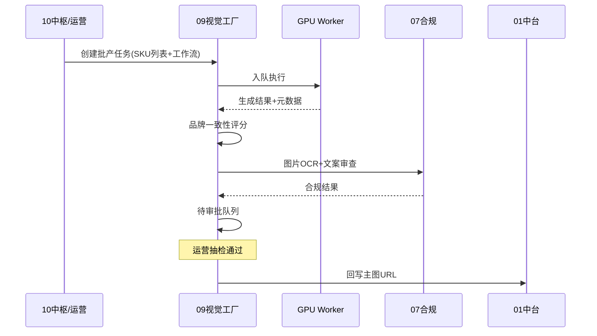

# 01-产品需求规格书

**产品名称**：跨境电商商品视觉智能生成与素材管理系统 V1.0  
**文档版本**：V1.0 | 2026-07-19  
**技术参考**：ComfyUI、product-shots、open-design

---

## 1. 文档说明

### 1.1 目的
定义视觉工厂的产品功能、工作流能力、品牌一致性、素材库管理及与跨境运营链路的集成需求。

### 1.2 术语

| 术语 | 定义 |
|------|------|
| 工作流 | 节点图形式的图像生成管线（类 ComfyUI JSON） |
| 品牌 Kit | 色板、字体、Logo 安全区、构图规范的集合 |
| 批产任务 | 对 N 个 SKU 应用同一工作流批量生成 |
| 素材版本 | 同一 SKU 同一用途下的迭代记录 |
| 白底图 | 商品抠图后的透明/白底 PNG |

---

## 2. 用户画像与场景

### 2.1 用户故事

| ID | 角色 | 故事 | 优先级 |
|----|------|------|--------|
| US-01 | 运营 | 上传白底图，5 分钟生成 5 张 Amazon 主图变体 | P0 |
| US-02 | 设计师 | 维护「厨房用品场景图」工作流模板 | P0 |
| US-03 | 品牌经理 | 配置品牌 Kit，生成图自动校验一致性 | P1 |
| US-04 | 运营 | 从素材库搜索 SKU 历史主图并回写 01 | P0 |
| US-05 | 合规 | 生成图自动送 07 审查图文合规 | P1 |
| US-06 | 运营 | 一键导出 TikTok/Meta 多尺寸广告图 | P1 |
| US-07 | Agent | 10 号中枢在新品流程中自动触发批产 | P1 |

### 2.2 场景：新品主图批产

---

## 3. 功能需求

### 3.1 模块总览

| 模块 | 说明 | 优先级 |
|------|------|--------|
| M1 工作流引擎 | 节点编排、执行、队列 | P0 |
| M2 模板市场 | 预置跨境模板 | P0 |
| M3 品牌 Kit | 色板、字体、约束 | P1 |
| M4 批产中心 | 任务、进度、重试 | P0 |
| M5 素材库 | 版本、标签、检索 | P0 |
| M6 导出中心 | 多平台尺寸预设 | P1 |
| M7 集成中心 | 01/07/10 | P0 |

### 3.2 M1 工作流引擎

#### F1.1 节点类型（V1.0）

| 节点 | 功能 |
|------|------|
| InputImage | 输入白底图/参考图 |
| RemoveBG | 抠图（内置或 API） |
| SceneGen | 场景合成/背景生成 |
| TextOverlay | 卖点文字叠加 |
| ResizeExport | 按预设裁切导出 |
| Watermark | 品牌水印 |
| LLMPrompt | 动态 Prompt 生成（接 LLM） |

#### F1.2 执行特性
- 支持 ComfyUI workflow JSON 导入（映射到内部节点）
- 任务队列：优先级、并发限制（按 GPU）
- 失败重试 3 次，支持断点续跑
- 输出：PNG/JPG/WebP + sidecar JSON（参数记录）

#### F1.3 GPU 调度
- 本地 GPU / 云 GPU 池可配置
- 队列可见：等待、执行中、完成、失败

### 3.3 M2 模板市场

#### 预置模板（V1.0 至少 6 个）

| 模板 ID | 名称 | 输出 |
|---------|------|------|
| TPL-AMZ-MAIN | Amazon 主图白底 | 2000×2000 白底 85% 占比 |
| TPL-AMZ-LIFESTYLE | Amazon 场景图 | 生活方式合成 |
| TPL-TT-PRODUCT | TikTok 商品卡 | 1:1 + 9:16 |
| TPL-META-AD | Meta 广告方图 | 1080×1080 |
| TPL-APLUS-BANNER | A+ 横幅 | 970×600 |
| TPL-BUNDLE | 多 SKU 组合图 | 自定义 |

#### 模板参数
- 运营可改：场景风格、卖点文案、色调
- 设计师锁定：构图网格、Logo 位置

### 3.4 M3 品牌 Kit

| 组件 | 说明 |
|------|------|
| 色板 | 主色/辅色/强调色 HEX |
| 字体 | 标题/正文字体族（授权检测提示） |
| Logo | 安全区、最小尺寸、变体 |
| 构图 | 商品占比范围、留白规则 |
| 禁用 | 竞品色、违规视觉元素 |

#### 一致性评分
- 自动检测：主色偏差、Logo 位置、文字对比度
- ≥85 分自动进入待审；<85 标记需设计师复核

### 3.5 M4 批产中心

- 输入：SKU 列表（来自 01）+ 模板 + 参数覆盖表（CSV）
- 进度：总数/完成/失败/待审
- 批量操作：全部通过、批量驳回、重新生成

### 3.6 M5 素材库

#### 素材元数据
- sku_id, asset_type(main/lifestyle/ad/aplus), version, status(draft/approved/archived)
- tags, platform, dimensions, file_url, thumbnail_url
- source(workflow/manual/upload), workflow_run_id
- brand_score, compliance_scan_id

#### 检索
- 按 SKU、标签、日期、状态、平台筛选
- 相似图搜索（可选 V1.5）

### 3.7 M6 导出中心

| 平台 | 预设尺寸 |
|------|----------|
| Amazon | 主图 2000², 缩略图 |
| TikTok | 1:1, 9:16, 16:9 |
| Meta | 1080², 1200×628 |
| Shopify | 2048² |

- 批量 ZIP 下载
- 命名规范：`{SKU}_{type}_{platform}_{version}.jpg`

### 3.8 M7 集成

| 系统 | 能力 |
|------|------|
| 01 | 拉取 SKU 白底图；回写 approved 素材 |
| 07 | 生成后触发 `compliance.scan_image` |
| 02 | 提供场景图给视频合成 |
| 08 | 提供达人 Brief 配图 |
| 10 | `visual.batch_generate`, `visual.get_assets` |

---

## 4. 非功能需求

| 类别 | 要求 |
|------|------|
| 性能 | 单图场景合成 P95 ≤ 120s（A10 级 GPU） |
| 存储 | 素材 S3/MinIO，CDN 加速 |
| 版权 | 生成参数与种子可追溯 |
| 安全 | 租户素材隔离；外链签名 URL |

---

## 5. 验收标准

| 编号 | 验收项 | 通过标准 |
|------|--------|----------|
| AC-01 | 主图批产 | 10 SKU × 5 变体任务完成率 ≥95% |
| AC-02 | 模板 | 6 个预置模板可一键使用 |
| AC-03 | 品牌 Kit | 色偏检测与评分可用 |
| AC-04 | 素材库 | 版本管理与 SKU 检索正确 |
| AC-05 | 07 联动 | 含文字图自动送审 |
| AC-06 | 01 回写 | 审批后主图 URL 写入中台 |
| AC-07 | ComfyUI | 导入示例 workflow 可执行 |

---

## 6. V1.0 范围

| 包含 | 后续 |
|------|------|
| 静态场景合成 | 视频封面动态生成 |
| 基础 OCR 合规联动 | 深度视觉侵权 |
| 单租户多品牌 Kit | 集团多品牌隔离 |

---

**审批**：产品 __________ | 研发 __________ | 设计负责人 __________
