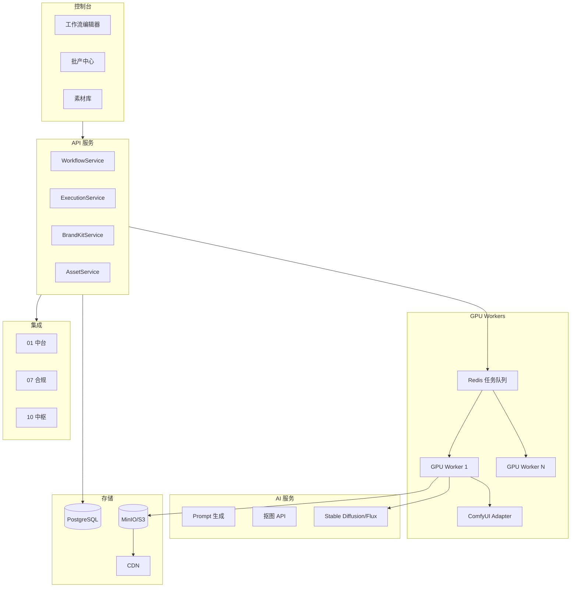

# 02-技术架构与数据设计

**产品**：跨境电商商品视觉智能生成与素材管理系统 V1.0  
**文档版本**：V1.0 | 2026-07-19

---

## 1. 系统架构



### 1.1 ComfyUI 集成模式

```text
内部 Workflow JSON
    ↔ ComfyUI Workflow Adapter（节点映射表）
    → ComfyUI API POST /prompt
    → WebSocket 监听进度
    → 输出文件拉取至 S3
    → 写入 workflow_runs + assets
```

**自研 vs ComfyUI**：
- ComfyUI：图像生成执行引擎（可替换）
- 自研：模板库、品牌约束、批产调度、素材版本、跨境尺寸预设

---

## 2. 核心模块

### 2.1 WorkflowService

- 工作流 CRUD、版本管理
- 节点校验（DAG 无环、必填端口）
- ComfyUI JSON 导入转换

### 2.2 ExecutionService

```typescript
interface BatchJobRequest {
  tenant_id: string;
  workflow_id: string;
  workflow_version: string;
  brand_kit_id?: string;
  items: Array<{
    sku_id: string;
    input_image_url: string;
    params_override?: Record<string, unknown>; // 卖点文案等
  }>;
  priority?: number;
}

interface WorkflowRun {
  id: string;
  status: 'queued' | 'running' | 'completed' | 'failed';
  progress: number;
  outputs: AssetRef[];
  brand_score?: number;
  compliance_scan_id?: string;
}
```

### 2.3 BrandKitService

- 色板校验：主色直方图 vs 品牌色 ΔE
- Logo 检测：模板位叠加透明度检查
- 输出 `brand_score` 0-100

### 2.4 AssetService

- 版本递增：`v1, v2, ...`
- 状态：draft → pending_review → approved → archived
- 审批后 Webhook 01

---

## 3. 数据库设计（字段级）

### 3.1 表：workflows

| 字段 | 类型 | 说明 |
|------|------|------|
| id | UUID | PK |
| tenant_id | UUID | NULL=平台模板 |
| name | VARCHAR(256) | |
| slug | VARCHAR(64) | 如 amz-main-white |
| category | VARCHAR(32) | main/lifestyle/ad/aplus |
| definition | JSONB | 内部节点图 |
| comfyui_export | JSONB | 原始 ComfyUI JSON |
| version | VARCHAR(16) | semver |
| status | VARCHAR(16) | draft/published |
| gpu_memory_mb | INT | 预估显存 |
| avg_duration_sec | INT | 历史均值 |
| created_by | UUID | |
| published_at | TIMESTAMPTZ | |

### 3.2 表：workflow_runs

| 字段 | 类型 | 说明 |
|------|------|------|
| id | UUID | PK |
| tenant_id | UUID | |
| workflow_id | UUID | FK |
| batch_job_id | UUID | FK, IDX |
| sku_id | UUID | |
| status | VARCHAR(16) | |
| input_params | JSONB | 完整参数快照 |
| seed | BIGINT | 可复现 |
| worker_id | VARCHAR(64) | |
| started_at | TIMESTAMPTZ | |
| completed_at | TIMESTAMPTZ | |
| error_message | TEXT | |
| brand_score | SMALLINT | |
| compliance_scan_id | UUID | |

### 3.3 表：batch_jobs

| 字段 | 类型 | 说明 |
|------|------|------|
| id | UUID | PK |
| tenant_id | UUID | |
| workflow_id | UUID | |
| brand_kit_id | UUID | |
| total_count | INT | |
| completed_count | INT | |
| failed_count | INT | |
| status | VARCHAR(16) | |
| created_by | UUID | |
| created_at | TIMESTAMPTZ | |

### 3.4 表：assets

| 字段 | 类型 | 说明 |
|------|------|------|
| id | UUID | PK |
| tenant_id | UUID | IDX |
| sku_id | UUID | IDX |
| asset_type | VARCHAR(32) | main/lifestyle/ad/aplus |
| version | INT | 同 type 递增 |
| status | VARCHAR(16) | draft/pending_review/approved/archived |
| platform | VARCHAR(32) | amazon/tiktok/meta/... |
| width | INT | |
| height | INT | |
| format | VARCHAR(8) | png/jpg/webp |
| file_url | TEXT | S3 |
| thumbnail_url | TEXT | |
| file_size_bytes | BIGINT | |
| tags | TEXT[] | |
| source | VARCHAR(16) | workflow/upload/manual |
| workflow_run_id | UUID | |
| brand_score | SMALLINT | |
| compliance_scan_id | UUID | |
| approved_by | UUID | |
| approved_at | TIMESTAMPTZ | |
| metadata | JSONB | prompt/模型信息 |
| created_at | TIMESTAMPTZ | |

### 3.5 表：brand_kits

| 字段 | 类型 | 说明 |
|------|------|------|
| id | UUID | PK |
| tenant_id | UUID | |
| name | VARCHAR(128) | |
| primary_color | CHAR(7) | #RRGGBB |
| secondary_color | CHAR(7) | |
| accent_color | CHAR(7) | |
| font_heading | VARCHAR(128) | |
| font_body | VARCHAR(128) | |
| logo_url | TEXT | |
| logo_safe_zone_pct | DECIMAL(4,2) | |
| product_area_min_pct | DECIMAL(4,2) | 商品占比下限 |
| product_area_max_pct | DECIMAL(4,2) | |
| forbidden_colors | TEXT[] | |
| overlay_style | JSONB | 文字区样式 |
| is_default | BOOLEAN | |
| created_at | TIMESTAMPTZ | |

### 3.6 表：export_presets

| 字段 | 类型 | 说明 |
|------|------|------|
| id | UUID | PK |
| platform | VARCHAR(32) | |
| name | VARCHAR(128) | |
| width | INT | |
| height | INT | |
| format | VARCHAR(8) | |
| quality | INT | JPG 质量 |
| naming_pattern | VARCHAR(256) | |

---

## 4. 核心 API

| 方法 | 路径 | 说明 |
|------|------|------|
| GET | /api/v1/workflows | 模板列表 |
| POST | /api/v1/workflows | 创建工作流 |
| POST | /api/v1/workflows/import-comfyui | 导入 ComfyUI JSON |
| POST | /api/v1/batch-jobs | 创建批产任务 |
| GET | /api/v1/batch-jobs/{id} | 进度 |
| GET | /api/v1/assets | 素材检索 |
| POST | /api/v1/assets/{id}/approve | 审批 |
| POST | /api/v1/assets/export | 批量导出 ZIP |
| GET | /api/v1/brand-kits | 品牌 Kit |

### 4.1 批产请求示例

```json
POST /api/v1/batch-jobs
{
  "workflow_id": "uuid",
  "brand_kit_id": "uuid",
  "items": [
    {
      "sku_id": "uuid",
      "input_image_url": "https://cdn.../white-bg.png",
      "params_override": {
        "selling_point": "Ergonomic grip, dishwasher safe",
        "scene_style": "modern_kitchen"
      }
    }
  ]
}
```

### 4.2 Agent 工具

```yaml
- name: visual.batch_generate
- name: visual.get_assets
- name: visual.approve_asset  # requires_approval: true
```

---

## 5. AI Prompt 模板

### 5.1 场景图 Prompt 生成（参考 product-shots）

```text
你是电商产品摄影 Prompt 工程师。根据商品信息生成 Stable Diffusion 场景图正向/负向 Prompt。

商品: {product_name}
品类: {category}
卖点: {selling_points}
品牌调性: {brand_tone}
场景风格: {scene_style}
目标平台: {platform}

品牌色: 主色 {primary_color}，需在场景中 subtly 体现

输出 JSON:
{
  "positive": "英文 prompt，含 lighting, composition, 8k, product hero shot...",
  "negative": "low quality, blurry, distorted product, watermark, text, logo, hands...",
  "camera": "50mm, f/2.8, soft natural light",
  "composition": "product occupies 60-70% center, clean background"
}

规则:
- 不得生成夸大功效文字
- 食品类不出现未授权品牌包装
- 儿童产品场景需安全合规
```

### 5.2 主图卖点文案叠加

```text
为 Amazon 主图生成简短卖点文字（图片叠加用）。

商品: {product_name}
卖点: {selling_points}
限制: 最多 2 行，每行 ≤ 28 字符，英文，无绝对化用语

输出 JSON: {"lines": ["line1", "line2"]}
```

### 5.3 品牌一致性评审（LLM 辅助）

```text
对比品牌 Kit 要求与生成图描述，评估一致性。

品牌要求: {brand_kit_json}
生成参数: {generation_metadata}
品牌色偏差: ΔE={delta_e}
Logo 检测: {logo_detected}

输出 JSON:
{"brand_score": 0-100, "issues": ["..."], "pass": true/false}
```

---

## 6. 部署方案

### 6.1 架构拓扑

```text
[API Server] ──► [Redis Queue] ──► [GPU Worker Pool]
                      │                    │
                      │              [ComfyUI :8188]
                      ▼
                 [PostgreSQL]
                      │
                 [MinIO] ──► [CDN]
```

### 6.2 GPU Worker Docker

```yaml
visual-gpu-worker:
  image: visual-factory/worker:1.0
  runtime: nvidia
  environment:
    COMFYUI_URL: http://comfyui:8188
    S3_ENDPOINT: ...
  deploy:
    resources:
      reservations:
        devices:
          - capabilities: [gpu]
```

### 6.3 资源规划

| 规模 | GPU | API | 存储 |
|------|-----|-----|------|
| 试用 | 1× RTX 3060 12G | 2C4G | 100GB |
| 标准 | 2× A10 | 4C8G×2 | 500GB + CDN |
| 企业 | 独立 GPU 池 | K8s | 对象存储 |

### 6.4 队列策略

- 优先级：人工触发 > Agent > 批量
- 并发：每 GPU 同时 1-2 任务（按显存）
- 超时：单任务 300s，超时 kill 并重试

---

## 7. 与 07 合规联动

批产完成后自动：
1. 若工作流含 TextOverlay → OCR + `comp.scan_listing`（image 字段）
2. `compliance_scan_id` 回写 `assets`
3. 高风险 → 状态保持 `pending_review`，禁止 approve

---

**维护**：视觉技术组 | GPU 运维手册另附
