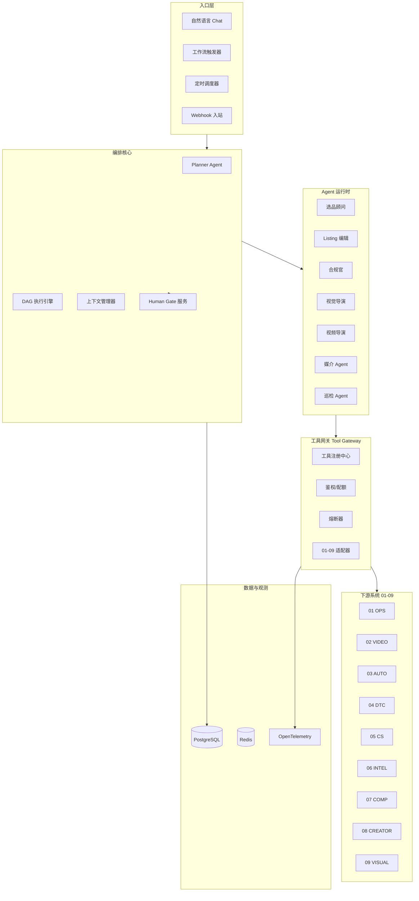

# 02-技术架构与数据设计

**产品**：跨境电商多智能体协同运营调度系统 V1.0  
**文档版本**：V1.0 | 2026-07-19

---

## 1. 系统架构



### 1.1 与 DeerFlow / n8n / atlas-mercator 的分工

| 组件 | 借鉴 | 本系统实现 |
|------|------|------------|
| DeerFlow | Planner + Worker 多轮对话 | 跨境领域 Agent + 固定 SOP 工作流 |
| n8n | 可视化节点、Webhook | 通用通知走 n8n；主 DAG 自研 |
| atlas-mercator | 工具地图、能力发现 | Tool Registry + OpenAPI 自动注册 |

---

## 2. 编排引擎设计

### 2.1 DAG 节点类型

| 类型 | 说明 | 示例 |
|------|------|------|
| ToolCall | 直接调用工具网关 | `comp.scan_listing` |
| AgentCall | 调用带工具的 Agent | Listing 编辑写文案 |
| HumanGate | 暂停等待审批 | 发布前确认 |
| Parallel | 并行分支 | 同时生成视觉+视频脚本 |
| Condition | 条件路由 | risk_score >= 70 → 终止 |
| Delay | 延迟 | 等待 24h 后跟进 |
| SubWorkflow | 子流程 | 复用 WF-DAILY-OPS |

### 2.2 Run 状态机

```text
created → planning → running → waiting_human → running → completed
                    ↘ failed ↙          ↘ cancelled
```

### 2.3 上下文（Context）结构

```json
{
  "run_id": "uuid",
  "tenant_id": "uuid",
  "shop_id": "uuid",
  "intent": "新品上架 Amazon US",
  "sku": { "id": "...", "title": "...", "category": "..." },
  "listing_draft": { },
  "compliance": { "scan_id": "...", "risk_score": 45 },
  "assets": [ { "asset_id": "...", "url": "..." } ],
  "deals": [ ],
  "variables": { },
  "_trace": [ ]
}
```

节点输出通过 JSONPath 合并到 Context。

---

## 3. 工具网关：01–09 全量注册表

### 3.1 工具清单

| 工具名 | 下游 | 方法 | risk | approval |
|--------|------|------|------|----------|
| intel.score_product | 06 | POST /api/v1/products/score | low | false |
| intel.competitor_snapshot | 06 | GET /api/v1/competitors/{asin} | low | false |
| comp.scan_listing | 07 | POST /api/v1/scans | low | false |
| comp.get_report | 07 | GET /api/v1/scans/{id}/report | low | false |
| visual.batch_generate | 09 | POST /api/v1/batch-jobs | medium | false |
| visual.get_assets | 09 | GET /api/v1/assets | low | false |
| visual.approve_asset | 09 | POST /api/v1/assets/{id}/approve | high | true |
| ops.get_sku | 01 | GET /api/v1/skus/{id} | low | false |
| ops.create_draft | 01 | POST /api/v1/listings/draft | medium | false |
| ops.publish_listing | 01 | POST /api/v1/listings/{id}/publish | high | true |
| video.generate_script | 02 | POST /api/v1/scripts | low | false |
| video.render | 02 | POST /api/v1/renders | medium | false |
| creator.match | 08 | POST /api/v1/match | low | false |
| creator.create_deal | 08 | POST /api/v1/deals | medium | false |
| creator.outreach_draft | 08 | POST /api/v1/outreach/draft | low | false |
| auto.ads_report | 03 | GET /api/v1/ads/daily-report | low | false |
| auto.inventory_check | 03 | GET /api/v1/inventory/alerts | low | false |
| cs.queue_summary | 05 | GET /api/v1/tickets/summary | low | false |
| dtc.sync_product | 04 | POST /api/v1/products/sync | medium | true |

### 3.2 适配器实现

```typescript
class ToolGateway {
  async invoke(toolName: string, args: object, ctx: RunContext): Promise<ToolResult> {
    const tool = this.registry.get(toolName);
    await this.auth.injectCredentials(ctx.tenant_id, tool.service);
    await this.rateLimiter.acquire(tool.service);
    if (tool.requires_approval && !ctx.approvals[toolName]) {
      throw new ApprovalRequiredError(toolName);
    }
    return this.circuitBreaker.exec(tool.service, () =>
      this.httpClient.request(tool.endpoint, args)
    );
  }
}
```

---

## 4. 预置工作流 DAG 定义（YAML）

### 4.1 WF-NEW-SKU

```yaml
id: WF-NEW-SKU
name: 新品上架全链路
version: "1.0"
trigger:
  type: manual
  # 也可: webhook from 06 when product.selected

steps:
  - id: score
    type: ToolCall
    tool: intel.score_product
    input:
      product_id: "{{ trigger.product_id }}"
    on_success:
      - condition: "{{ steps.score.output.score >= 60 }}"
        goto: compliance_pre
      - else: abort
        message: 选品分数不足

  - id: compliance_pre
    type: AgentCall
    agent: listing_editor
    instruction: 根据选品报告生成 Amazon US Listing 草稿 JSON
    tools: [ops.get_sku]

  - id: scan_pre
    type: ToolCall
    tool: comp.scan_listing
    input:
      listing: "{{ context.listing_draft }}"
    on_success:
      - condition: "{{ steps.scan_pre.output.risk_score >= 70 }}"
        goto: human_fix_compliance
      - else: visual_batch

  - id: visual_batch
    type: ToolCall
    tool: visual.batch_generate
    input:
      workflow_id: "tpl-amz-main"
      items: "[{ sku_id: context.sku.id, input_image_url: context.sku.white_bg_url }]"

  - id: gate_assets
    type: HumanGate
    title: 主图审批
  - id: create_draft
    type: ToolCall
    tool: ops.create_draft
    input:
      sku_id: "{{ context.sku.id }}"
      listing: "{{ context.listing_draft }}"
      images: "{{ context.assets }}"

  - id: scan_final
    type: ToolCall
    tool: comp.scan_listing
    input:
      listing_id: "{{ steps.create_draft.output.listing_id }}"

  - id: gate_publish
    type: HumanGate
    title: 确认发布 Listing
    required_role: ops_lead

  - id: publish
    type: ToolCall
    tool: ops.publish_listing
    input:
      listing_id: "{{ steps.create_draft.output.listing_id }}"
```

### 4.2 WF-TIKTOK-CAMPAIGN

```yaml
id: WF-TIKTOK-CAMPAIGN
steps:
  - { id: sku, type: ToolCall, tool: ops.get_sku }
  - { id: visuals, type: ToolCall, tool: visual.batch_generate }
  - { id: script, type: ToolCall, tool: video.generate_script }
  - { id: match, type: ToolCall, tool: creator.match }
  - { id: outreach, type: ToolCall, tool: creator.outreach_draft }
  - { id: gate_outreach, type: HumanGate, title: 确认达人触达名单 }
  - { id: deal, type: ToolCall, tool: creator.create_deal }
```

### 4.3 WF-DAILY-OPS（定时 08:00）

```yaml
id: WF-DAILY-OPS
trigger:
  type: schedule
  cron: "0 8 * * *"
steps:
  - { id: ads, type: ToolCall, tool: auto.ads_report }
  - { id: inv, type: ToolCall, tool: auto.inventory_check }
  - { id: cs, type: ToolCall, tool: cs.queue_summary }
  - { id: rescan, type: ToolCall, tool: comp.scan_listing, input: { mode: scheduled } }
  - id: report
    type: AgentCall
    agent: ops_reporter
    instruction: 汇总今日巡检结果，生成中文日报 Markdown
```

---

## 5. 数据库设计（字段级）

### 5.1 表：workflow_definitions

| 字段 | 类型 | 说明 |
|------|------|------|
| id | UUID | PK |
| tenant_id | UUID | NULL=系统预置 |
| workflow_key | VARCHAR(64) | WF-NEW-SKU |
| name | VARCHAR(256) | |
| version | VARCHAR(16) | |
| definition | JSONB | DAG YAML/JSON |
| status | VARCHAR(16) | draft/published |
| created_at | TIMESTAMPTZ | |

### 5.2 表：workflow_runs

| 字段 | 类型 | 说明 |
|------|------|------|
| id | UUID | PK |
| tenant_id | UUID | IDX |
| shop_id | UUID | |
| workflow_id | UUID | FK |
| workflow_key | VARCHAR(64) | |
| status | VARCHAR(16) | |
| trigger_type | VARCHAR(32) | manual/schedule/webhook/chat |
| trigger_payload | JSONB | |
| context | JSONB | 运行时上下文 |
| current_step_id | VARCHAR(64) | |
| error_message | TEXT | |
| started_by | UUID | |
| started_at | TIMESTAMPTZ | |
| completed_at | TIMESTAMPTZ | |
| total_tokens | INT | |
| total_cost_usd | DECIMAL(10,4) | |

### 5.3 表：workflow_steps

| 字段 | 类型 | 说明 |
|------|------|------|
| id | UUID | PK |
| run_id | UUID | FK, IDX |
| step_id | VARCHAR(64) | DAG 节点 id |
| step_type | VARCHAR(32) | |
| status | VARCHAR(16) | pending/running/completed/failed/skipped |
| input_snapshot | JSONB | |
| output_snapshot | JSONB | |
| started_at | TIMESTAMPTZ | |
| completed_at | TIMESTAMPTZ | |
| retry_count | INT | |

### 5.4 表：tool_invocations

| 字段 | 类型 | 说明 |
|------|------|------|
| id | UUID | PK |
| run_id | UUID | IDX |
| step_id | UUID | FK |
| tool_name | VARCHAR(64) | |
| service | VARCHAR(16) | 01-09 |
| request_body | JSONB | 脱敏 |
| response_body | JSONB | 脱敏 |
| status | VARCHAR(16) | |
| latency_ms | INT | |
| trace_id | VARCHAR(64) | |
| created_at | TIMESTAMPTZ | |

### 5.5 表：human_gates

| 字段 | 类型 | 说明 |
|------|------|------|
| id | UUID | PK |
| run_id | UUID | FK |
| step_id | VARCHAR(64) | |
| title | VARCHAR(256) | |
| summary | TEXT | Agent 生成的摘要 |
| payload | JSONB | 待审内容 |
| status | VARCHAR(16) | pending/approved/rejected |
| assignee_role | VARCHAR(32) | |
| resolved_by | UUID | |
| resolution_comment | TEXT | |
| created_at | TIMESTAMPTZ | |
| resolved_at | TIMESTAMPTZ | |

### 5.6 表：tool_registry

| 字段 | 类型 | 说明 |
|------|------|------|
| id | UUID | PK |
| name | VARCHAR(64) | UNIQUE |
| service | VARCHAR(16) | |
| endpoint | TEXT | |
| method | VARCHAR(8) | |
| schema | JSONB | OpenAPI fragment |
| risk_level | VARCHAR(16) | |
| requires_approval | BOOLEAN | |
| timeout_ms | INT | |
| is_active | BOOLEAN | |

### 5.7 表：agent_profiles

| 字段 | 类型 | 说明 |
|------|------|------|
| id | UUID | PK |
| name | VARCHAR(64) | listing_editor |
| system_prompt | TEXT | |
| tool_allowlist | TEXT[] | |
| model | VARCHAR(64) | |
| prompt_version | VARCHAR(16) | |
| temperature | DECIMAL(2,1) | |

---

## 6. 核心 API

| 方法 | 路径 | 说明 |
|------|------|------|
| POST | /api/v1/runs | 启动工作流 |
| GET | /api/v1/runs/{id} | Run 状态与 Context |
| POST | /api/v1/runs/{id}/cancel | 取消 |
| GET | /api/v1/human-gates | 待办列表 |
| POST | /api/v1/human-gates/{id}/resolve | 审批 |
| POST | /api/v1/chat | 自然语言 → Planner 选工作流 |
| GET | /api/v1/workflows | 工作流模板 |
| GET | /api/v1/audit/runs/{id}/trace | 全链路追踪 |
| GET | /api/v1/metrics/dashboard | 成功率/成本 |

### 6.1 启动 Run

```json
POST /api/v1/runs
{
  "workflow_key": "WF-NEW-SKU",
  "shop_id": "uuid",
  "input": {
    "product_id": "uuid",
    "sku_id": "uuid"
  }
}
```

---

## 7. AI Prompt 模板

### 7.1 Planner Agent

```text
你是跨境电商运营调度 Planner。用户意图如下:
"""
{user_intent}
"""

当前店铺上下文:
- 店铺: {shop_name}
- 平台: {platforms}
- 近期任务: {recent_runs_summary}

可用工作流:
{workflow_catalog_json}

可用工具摘要:
{tool_catalog_summary}

任务:
1. 判断应触发哪个 workflow_key，或是否需要组合多个
2. 提取 input 参数
3. 识别需要人工确认的风险点

输出 JSON:
{
  "workflow_key": "WF-NEW-SKU",
  "input": { },
  "reasoning": "中文说明",
  "estimated_human_gates": ["主图审批", "发布确认"],
  "clarifying_questions": []  // 若信息不足
}
```

### 7.2 Listing 编辑 Agent

```text
你是 Amazon Listing 专家 Agent。根据选品情报撰写合规导向的 Listing 草稿。

选品报告: {intel_report}
SKU 信息: {sku_json}
目标市场: {marketplace}
品牌调性: {brand_voice}

约束:
- 标题 ≤ 200 字符
- 五点每条 ≤ 256 字符
- 禁止绝对化用语
- 完成后调用 comp.scan_listing 自检（若工具可用）

输出 JSON 符合 ops.create_draft 接口格式。
```

### 7.3 巡检日报 Agent

```text
根据以下巡检数据生成运营日报（Markdown，中文）:

广告报告(03): {ads_report}
库存预警(03): {inventory_alerts}
客服摘要(05): {cs_summary}
合规复检(07): {compliance_rescan}

结构:
1. 执行摘要（3 条）
2. 需立即处理（P0）
3. 建议优化（P1）
4. 数据附录

语气简洁，可直接发钉钉群。
```

---

## 8. 部署方案

```yaml
services:
  orchestrator-api:
    image: ops-orchestrator/api:1.0
    ports: ["8010:8000"]
  orchestrator-worker:
    image: ops-orchestrator/worker:1.0
  planner-service:
    image: ops-orchestrator/planner:1.0
  postgres:
    image: postgres:15
  redis:
    image: redis:7
  n8n:  # 可选，通用集成
    image: n8nio/n8n
```

### 8.1 网络与安全

- 工具网关与 01–09 内网通信（VPC / K8s Service Mesh）
- 每租户独立 Service Account / API Key
- mTLS 可选（企业版）

### 8.2 高可用

- API 无状态水平扩展
- Worker 竞争消费 Redis Stream
- Run 状态持久化 PostgreSQL，支持断点续跑

### 8.3 观测

- OpenTelemetry trace_id 贯穿 Run → Step → Tool
- Grafana 看板：工作流成功率、P95 耗时、人工闸口积压

---

**维护**：平台架构组 | 每新增 01–09 工具须注册 tool_registry
