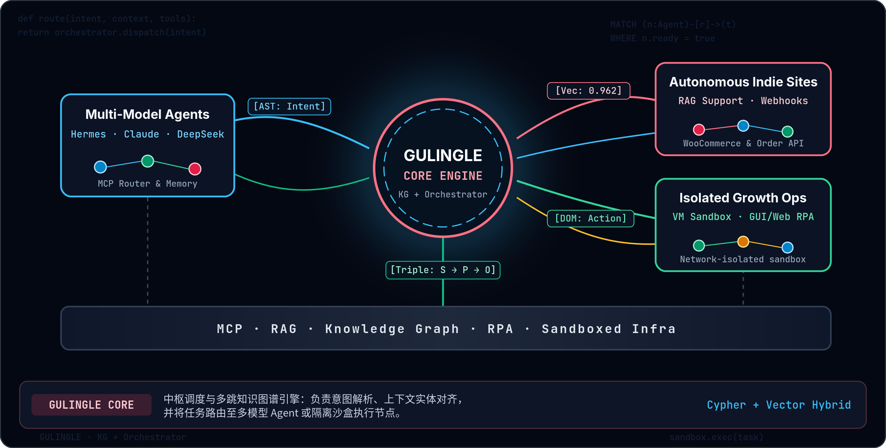

<!DOCTYPE html>
<html lang="zh-CN">
<head>
  <meta charset="UTF-8" />
  <meta name="viewport" content="width=device-width, initial-scale=1.0" />
  <title>GULINGLE · GitHub Profile Live Preview &amp; Studio</title>
  <!-- Tailwind CSS -->
  
  <!-- Google Fonts: Inter & JetBrains Mono -->
  <link rel="preconnect" href="https://fonts.googleapis.com" />
  <link rel="preconnect" href="https://fonts.gstatic.com" crossorigin />
  <link href="https://fonts.googleapis.com/css2?family=Inter:wght@300;400;500;600;700;800;900&family=JetBrains+Mono:wght@400;500;600;700&display=swap" rel="stylesheet" />
  
</head>
<body class="bg-[#010409] text-[#e6edf3] min-h-screen flex flex-col selection:bg-rose-500/30 selection:text-rose-200">

  <!-- =====================================================================
       1. TOP CUSTOMIZER CONTROL BAR
       ===================================================================== -->
  <header class="sticky top-0 z-40 bg-[#0d1117]/95 backdrop-blur-md border-b border-[#30363d] px-3 sm:px-6 py-2.5 shadow-lg">
    

      <!-- Left Brand & Status -->
      

        
          &gt;_
        
        

          

            GULINGLE · GitHub 主页预览与源码工坊
            
              EDITORIAL UI
            
          

        

      

      <!-- Center Interactive Toggles -->
      

        <!-- Theme Toggle -->
        

          <button id="btn-theme-dark" type="button" onclick="setTheme('dark')"
            class="px-2.5 py-1 rounded-md font-medium bg-[#21262d] text-white shadow-sm transition-colors">
            🌙 Dark
          </button>
          <button id="btn-theme-light" type="button" onclick="setTheme('light')"
            class="px-2.5 py-1 rounded-md font-medium text-[#8b949e] hover:text-white transition-colors">
            ☀️ Light
          </button>
        

        <!-- Language Toggle -->
        <button id="btn-lang-toggle" type="button" onclick="toggleLang()"
          class="px-2.5 py-1.5 rounded-lg font-medium bg-[#161b22] hover:bg-[#21262d] text-[#c9d1d9] border border-[#30363d] transition-colors">
          🌐 中英双语
        </button>

        <!-- Section Visibility Toggles -->
        <button id="btn-toggle-arch" type="button" onclick="toggleSection('arch')"
          class="px-2.5 py-1.5 rounded-lg font-medium bg-emerald-500/15 text-emerald-300 border border-emerald-500/40 transition-colors">
          ✓ 知识图谱架构
        </button>
        <button id="btn-toggle-stats" type="button" onclick="toggleSection('stats')"
          class="px-2.5 py-1.5 rounded-lg font-medium bg-emerald-500/15 text-emerald-300 border border-emerald-500/40 transition-colors">
          ✓ 数据看板
        </button>
        <button id="btn-toggle-pins" type="button" onclick="toggleSection('pins')"
          class="px-2.5 py-1.5 rounded-lg font-medium bg-emerald-500/15 text-emerald-300 border border-emerald-500/40 transition-colors">
          ✓ 四宫格置顶
        </button>
      

      <!-- Right Action Buttons -->
      

        <button type="button" onclick="openGifStudioModal()"
          class="px-3 py-1.5 rounded-lg text-xs font-semibold bg-rose-500/20 hover:bg-rose-500/30 text-rose-200 border border-rose-400/50 transition-colors flex items-center gap-1.5 shadow-sm">
          🎬
          生成动态 GIF
        </button>
        <button type="button" onclick="openMarkdownModal()"
          class="px-3 py-1.5 rounded-lg text-xs font-medium bg-[#161b22] hover:bg-[#21262d] text-[#c9d1d9] border border-[#30363d] transition-colors">
          查看完整代码
        </button>
        <button id="btn-copy-readme" type="button" onclick="copyReadmeMarkdown()"
          class="px-3 py-1.5 rounded-lg text-xs font-semibold bg-[#238636] hover:bg-[#2ea043] text-white border border-emerald-400/30 transition-colors shadow-sm">
          📋 复制 README.md
        </button>
      

    

  </header>

  <!-- =====================================================================
       2. SIMULATED GITHUB PROFILE NAVIGATION TABS
       ===================================================================== -->
  <nav id="gh-subnav" class="bg-[#010409] border-b border-[#30363d] px-4 sm:px-8 pt-3 transition-colors">
    

      

        <svg class="w-4 h-4 opacity-80" fill="currentColor" viewBox="0 0 16 16"><path d="M2 2.5A2.5 2.5 0 0 1 4.5 0h8.75a.75.75 0 0 1 .75.75v12.5a.75.75 0 0 1-.75.75h-2.5a.75.75 0 0 1 0-1.5h1.75v-2h-8a1 1 0 0 0-.714 1.7.75.75 0 1 1-1.072 1.05A2.495 2.495 0 0 1 2 11.5Zm10.5-1h-8a1 1 0 0 0-1 1v6.708A2.486 2.486 0 0 1 4.5 9h8ZM5 12.25a.25.25 0 0 1 .25-.25h3.5a.25.25 0 0 1 .25.25v3.25a.25.25 0 0 1-.4.2l-1.45-1.087a.249.249 0 0 0-.3 0L5.4 15.7a.25.25 0 0 1-.4-.2Z"/></svg>
        Overview
      

      

        <svg class="w-4 h-4" fill="currentColor" viewBox="0 0 16 16"><path d="M2 2.5A2.5 2.5 0 0 1 4.5 0h8.75a.75.75 0 0 1 .75.75v12.5a.75.75 0 0 1-.75.75h-2.5a.75.75 0 0 1 0-1.5h1.75v-2h-8a1 1 0 0 0-.714 1.7.75.75 0 1 1-1.072 1.05A2.495 2.495 0 0 1 2 11.5Zm10.5-1h-8a1 1 0 0 0-1 1v6.708A2.486 2.486 0 0 1 4.5 9h8Z"/></svg>
        Repositories
        12
      

      

        Projects
      

      

        Packages
      

      

        Stars
        48
      

    

  </nav>

  <!-- =====================================================================
       3. MAIN TWO-COLUMN GITHUB PROFILE WORKSPACE
       ===================================================================== -->
  <main id="gh-main-container" class="flex-1 bg-[#0d1117] text-[#e6edf3] px-4 sm:px-8 py-6 sm:py-8 transition-colors">
    

      <!-- =================================================================
           LEFT SIDEBAR (USER PROFILE INFO & ORIGINAL HUSKY AVATAR)
           ================================================================= -->
      <aside class="lg:col-span-3 space-y-4">
        

          

            <!-- Custom Uploaded Image Layer -->
            

            <!-- Default Illustrated Husky with Iced Coffee & ID Badge (Matches Original Avatar) -->
            <svg id="avatar-default-svg" viewBox="0 0 260 260" class="w-full h-full block" xmlns="http://www.w3.org/2000/svg">
              <defs>
                <radialGradient id="officeBg" cx="50%" cy="40%" r="70%">
                  <stop offset="0%" stop-color="#334155" />
                  <stop offset="100%" stop-color="#0f172a" />
                </radialGradient>
                <linearGradient id="coffeeCup" x1="0%" y1="0%" x2="100%" y2="0%">
                  <stop offset="0%" stop-color="#3b1d0e" />
                  <stop offset="50%" stop-color="#1e0d05" />
                  <stop offset="100%" stop-color="#451a03" />
                </linearGradient>
              </defs>
              <rect width="260" height="260" fill="url(#officeBg)" />
              <rect x="0" y="175" width="260" height="85" fill="#1e293b" />
              <rect x="14" y="132" width="58" height="12" rx="3" fill="#475569" opacity="0.55" transform="rotate(-12 14 132)" />
              <ellipse cx="122" cy="198" rx="76" ry="68" fill="#f8fafc" />
              <path d="M55 185 Q75 135 122 135 Q168 135 188 185 Z" fill="#cbd5e1" />
              <polygon points="74,95 62,38 106,72" fill="#1e293b" />
              <polygon points="78,86 70,50 98,74" fill="#fbcfe8" opacity="0.7" />
              <polygon points="168,95 182,38 138,72" fill="#1e293b" />
              <polygon points="164,86 174,50 146,74" fill="#fbcfe8" opacity="0.7" />
              <ellipse cx="122" cy="108" rx="54" ry="48" fill="#1e293b" />
              <path d="M76 112 Q84 78 108 86 Q122 92 136 86 Q160 78 168 112 Q168 150 122 152 Q76 150 76 112 Z" fill="#f8fafc" />
              <polygon points="122,68 114,92 130,92" fill="#f8fafc" />
              <ellipse cx="104" cy="92" rx="4.5" ry="3" fill="#f8fafc" />
              <ellipse cx="140" cy="92" rx="4.5" ry="3" fill="#f8fafc" />
              <circle cx="103" cy="104" r="6" fill="#0f172a" />
              <circle cx="105" cy="102" r="2" fill="#38bdf8" />
              <circle cx="141" cy="104" r="6" fill="#0f172a" />
              <circle cx="143" cy="102" r="2" fill="#38bdf8" />
              <ellipse cx="122" cy="122" rx="9" ry="6.5" fill="#0f172a" />
              <path d="M108 132 Q122 142 136 132" stroke="#334155" stroke-width="2.5" fill="none" stroke-linecap="round" />
              <path d="M92 146 L114 192 L130 192 L152 146" stroke="#15803d" stroke-width="6" fill="none" />
              <rect x="103" y="188" width="38" height="48" rx="4" fill="#f1f5f9" stroke="#94a3b8" stroke-width="1.5" />
              <circle cx="122" cy="207" r="10" fill="#64748b" />
              <rect x="110" y="222" width="24" height="4" rx="2" fill="#0f172a" />
              <ellipse cx="152" cy="186" rx="22" ry="15" fill="#f8fafc" stroke="#cbd5e1" stroke-width="1.5" />
              <line x1="176" y1="92" x2="168" y2="132" stroke="#16a34a" stroke-width="4.5" stroke-linecap="round" />
              <polygon points="146,128 194,128 187,196 153,196" fill="url(#coffeeCup)" stroke="#e2e8f0" stroke-width="1.5" />
              <ellipse cx="170" cy="128" rx="24" ry="5" fill="#cbd5e1" opacity="0.85" />
              <rect x="155" y="133" width="11" height="10" rx="2" fill="#e0f2fe" opacity="0.45" transform="rotate(12 155 133)" />
              <rect x="171" y="135" width="12" height="10" rx="2" fill="#e0f2fe" opacity="0.4" transform="rotate(-10 171 135)" />
              <circle cx="170" cy="162" r="13" fill="#15803d" stroke="#f8fafc" stroke-width="1.2" />
              <circle cx="170" cy="162" r="6" fill="#f8fafc" />
            </svg>

            <!-- Hover Action to Load User's Exact Local Avatar File -->
            <label for="avatar-file-input"
              class="opacity-0 group-hover:opacity-100 transition-opacity absolute inset-0 bg-black/70 flex flex-col items-center justify-center text-center p-2 cursor-pointer text-white">
              📷
              载入本地原头像
              支持 JPG / PNG / WebP
            </label>
            <input id="avatar-file-input" type="file" accept="image/*" class="hidden" onchange="handleAvatarUpload(event)" />
          

          <!-- Name & Handle -->
          

            <h1 class="text-xl sm:text-2xl font-bold tracking-tight leading-tight">GULINGLE</h1>
            
gulingle

          

        

        <!-- Bio -->
        

          Founder &amp; AI Builder | Creator of GUKi. Architecting multi-model agent workspaces, autonomous indie sites &amp; full-stack growth engines.
        

        <!-- Edit Profile Button -->
        <button type="button" onclick="showToast('提示：你的 Bio 长度 136/160 字符，布局已达到最佳比例！')"
          class="w-full py-1.5 px-3 rounded-md text-xs font-semibold bg-[#21262d] hover:bg-[#30363d] text-[#c9d1d9] border border-[#30363d] transition-colors">
          Edit profile
        </button>

        <!-- Followers & Meta Links -->
        

          

            <svg class="w-4 h-4" fill="currentColor" viewBox="0 0 16 16"><path d="M2 5.5a3.5 3.5 0 1 1 5.898 2.549 5.508 5.508 0 0 1 3.034 4.084.75.75 0 1 1-1.482.235 4 4 0 0 0-7.9 0 .75.75 0 0 1-1.482-.236A5.507 5.507 0 0 1 3.102 8.05 3.493 3.493 0 0 1 2 5.5ZM11 4a3.001 3.001 0 0 1 2.22 5.018 5.01 5.01 0 0 1 2.56 3.012.749.749 0 0 1-.885.954.752.752 0 0 1-.549-.514 3.507 3.507 0 0 0-2.522-2.372.75.75 0 0 1-.574-.73v-.352a.75.75 0 0 1 .416-.672A1.5 1.5 0 0 0 11 5.5.75.75 0 0 1 11 4Zm-5.5-.5a2 2 0 1 0-.001 3.999A2 2 0 0 0 5.5 3.5Z"/></svg>
            <strong class="text-[#e6edf3]">1</strong> follower · <strong class="text-[#e6edf3]">5</strong> following
          

          

            🏢
            GULINGLE
          

          

            🔗
            <a href="https://gulingle.cn" target="_blank" rel="noopener" class="hover:text-rose-300 hover:underline">https://gulingle.cn</a>
          

          

            𝕏
            <a href="https://x.com/GULINGLE" target="_blank" rel="noopener" class="hover:text-rose-300 hover:underline">@GULINGLE</a>
          

        

        <!-- Achievements -->
        

          <h2 class="text-xs font-semibold uppercase tracking-wider text-[#8b949e] mb-2.5">Achievements</h2>
          

            

              

                YOLO
              

            

            

              

                🦈
              

            

          

        

      </aside>

      <!-- =================================================================
           RIGHT MAIN COLUMN (README.md + PINNED REPOS + CONTRIBUTION GRAPH)
           ================================================================= -->
      <section class="lg:col-span-9 space-y-6">

        <!-- README.md Container Card -->
        

          <!-- README Top File Bar -->
          

            

              
              GULINGLE / <strong class="text-[#e6edf3]">README.md</strong>
            

            <button type="button" onclick="openMarkdownModal()" class="hover:text-rose-300 transition-colors" title="查看并复制 Markdown">
              ✏️ Edit / Raw
            </button>
          

          <!-- README Rendered Content -->
          

            <!-- 1. HERO BANNER: CINEMATIC PARTED CLIFF & EDITORIAL TECH UI TYPOGRAPHY -->
            

              <canvas id="hero-editorial-canvas" class="w-full h-full block"></canvas>

              <!-- Subtle Hover Quick-Action Bar -->
              

                <label for="banner-file-input"
                  class="px-2.5 py-1.5 rounded-md bg-black/75 hover:bg-black/90 text-slate-200 border border-white/20 text-[11px] font-mono-code flex items-center gap-1.5 shadow-lg backdrop-blur-md cursor-pointer">
                  🖼️
                  载入本地横幅原图
                </label>
                <input id="banner-file-input" type="file" accept="image/*" class="hidden" onchange="handleBannerImageUpload(event)" />

                <button type="button" onclick="openGifStudioModal()"
                  class="px-2.5 py-1.5 rounded-md bg-black/75 hover:bg-rose-950/90 text-rose-200 border border-rose-400/40 text-[11px] font-mono-code flex items-center gap-1.5 shadow-lg backdrop-blur-md">
                  🎬
                  导出 GIF 动图
                </button>
              

            

            <!-- 2. CLEAN MINIMAL SOCIAL & PROJECT BADGES -->
            

              

                
                BUILDING IN PUBLIC · SHANGHAI / GLOBAL
              

              

                <a href="https://gulingle.cn" target="_blank" rel="noopener"
                  class="inline-flex items-center rounded overflow-hidden text-[11px] font-mono-code font-bold tracking-wider shadow border border-[#30363d]">
                  WEB
                  GULINGLE.CN
                </a>
                <a href="https://x.com/GULINGLE" target="_blank" rel="noopener"
                  class="inline-flex items-center rounded overflow-hidden text-[11px] font-mono-code font-bold tracking-wider shadow border border-[#30363d]">
                  X
                  @GULINGLE
                </a>
                <a href="https://github.com/gulingle?tab=repositories" target="_blank" rel="noopener"
                  class="inline-flex items-center rounded overflow-hidden text-[11px] font-mono-code font-bold tracking-wider shadow border border-[#30363d]">
                  FLAGSHIP
                  GUKi_WORKSPACE
                </a>
              

            

            

            <!-- 3. WHAT I'M BUILDING (2x2 GRID CARDS) -->
            

              <h3 class="text-base sm:text-lg font-bold flex items-center gap-2">
                🚀
                What I'm Building · 核心构建方向
              </h3>

              

                <!-- Card 1 -->
                

                  <h4 class="text-sm font-bold text-rose-300">🧠 GUKi — Multi-Model Agent Workspaces</h4>
                  

                    Cross-platform desktop workspaces for multi-model orchestration, MCP tool routing, and human-in-the-loop agent workflows.
                  

                  

                    跨平台多模型协作工作台，聚焦模型统一调度、MCP 工具链与人机协同自动化流。
                  

                

                <!-- Card 2 -->
                

                  <h4 class="text-sm font-bold text-amber-300">🌐 Autonomous Indie Sites</h4>
                  

                    Self-operating site and commerce infrastructure: RAG knowledge-base support, tool-calling AI assistants, and automated order pipelines.
                  

                  

                    全自动独立站与商业基建：知识库智能客服、工具调用型助手及订单自动化闭环。
                  

                

                <!-- Card 3 -->
                

                  <h4 class="text-sm font-bold text-emerald-400">⚙️ Full-Stack Growth &amp; Isolated Ops</h4>
                  

                    Sandboxed execution environments, browser &amp; desktop visual RPA agents, and resilient automation for scalable operations.
                  

                  

                    物理级隔离执行环境、浏览器与桌面级视觉智能体，以及可规模化的自动化运维。
                  

                

                <!-- Card 4 -->
                

                  <h4 class="text-sm font-bold text-sky-400">📡 Engineering Philosophy</h4>
                  

                    Isolate complexity at the infrastructure layer so autonomous AI agents can execute cleanly and reliably at the surface.
                  

                  

                    在底层基础设施封装复杂性与隔离边界，让上层多智能体实现高可靠、低干扰的自治运行。
                  

                

              

            

            <!-- 4. INTERACTIVE CODE + MULTI-HOP KNOWLEDGE GRAPH ARCHITECTURE BLUEPRINT -->
            

              

                <h3 class="text-base sm:text-lg font-bold flex items-center gap-2">
                  🧩
                  System Architecture &amp; Knowledge Graph · 代码与知识图谱架构
                </h3>
                
                  点击节点查看图谱拓扑链路
                
              

              

                <!-- Background Live Code & Graph Particle Canvas -->
                <canvas id="arch-code-canvas" class="absolute inset-0 w-full h-full pointer-events-none opacity-65"></canvas>

                <!-- Foreground Interactive Multi-Hop Knowledge Graph SVG -->
                

                  <svg viewBox="0 0 860 360" class="w-full h-auto block select-none" xmlns="http://www.w3.org/2000/svg">
                    <defs>
                      <radialGradient id="coreGlow" cx="50%" cy="50%" r="50%">
                        <stop offset="0%" stop-color="#f43f5e" stop-opacity="0.35" />
                        <stop offset="55%" stop-color="#38bdf8" stop-opacity="0.16" />
                        <stop offset="100%" stop-color="#040812" stop-opacity="0" />
                      </radialGradient>
                      <linearGradient id="busGrad" x1="0%" y1="0%" x2="100%" y2="0%">
                        <stop offset="0%" stop-color="#0f172a" />
                        <stop offset="50%" stop-color="#1e293b" />
                        <stop offset="100%" stop-color="#0f172a" />
                      </linearGradient>
                    </defs>

                    <circle cx="430" cy="155" r="145" fill="url(#coreGlow)" />

                    <!-- Multi-Hop Knowledge Graph Semantic Edges -->
                    <g id="kg-edges-group">
                      <path d="M 355 135 C 295 105, 255 95, 205 110" stroke="#38bdf8" stroke-width="2" fill="none" class="kg-edge-animated" />
                      <path d="M 355 165 C 295 185, 255 180, 205 155" stroke="#10b981" stroke-width="1.5" fill="none" class="kg-edge-animated" />
                      <path d="M 505 125 C 565 85, 605 75, 655 88" stroke="#fb7185" stroke-width="2" fill="none" class="kg-edge-animated" />
                      <path d="M 505 145 C 565 130, 605 125, 655 118" stroke="#38bdf8" stroke-width="1.5" fill="none" class="kg-edge-animated" />
                      <path d="M 505 168 C 565 188, 605 198, 655 208" stroke="#34d399" stroke-width="2" fill="none" class="kg-edge-animated" />
                      <path d="M 505 185 C 565 225, 605 235, 655 232" stroke="#fbbf24" stroke-width="1.5" fill="none" class="kg-edge-animated" />
                      <line x1="130" y1="185" x2="130" y2="296" stroke="#334155" stroke-width="1.5" stroke-dasharray="4 4" />
                      <line x1="430" y1="225" x2="430" y2="296" stroke="#10b981" stroke-width="2" class="kg-edge-animated" />
                      <line x1="735" y1="258" x2="735" y2="296" stroke="#334155" stroke-width="1.5" stroke-dasharray="4 4" />
                    </g>

                    <!-- Semantic Knowledge Graph Triple Tags -->
                    <g font-family="JetBrains Mono, monospace" font-size="9.5">
                      <rect x="232" y="84" width="84" height="17" rx="4" fill="#091322" stroke="#38bdf8" stroke-width="0.8" />
                      <text x="274" y="95.5" fill="#7dd3fc" text-anchor="middle">[AST: Intent]</text>

                      <rect x="536" y="68" width="84" height="17" rx="4" fill="#091322" stroke="#fb7185" stroke-width="0.8" />
                      <text x="578" y="79.5" fill="#fecdd3" text-anchor="middle">[Vec: 0.962]</text>

                      <rect x="536" y="198" width="88" height="17" rx="4" fill="#091322" stroke="#34d399" stroke-width="0.8" />
                      <text x="580" y="209.5" fill="#6ee7b7" text-anchor="middle">[DOM: Action]</text>

                      <rect x="372" y="250" width="116" height="18" rx="4" fill="#091322" stroke="#10b981" stroke-width="0.9" />
                      <text x="430" y="262" fill="#a7f3d0" text-anchor="middle">[Triple: S → P → O]</text>
                    </g>

                    <!-- Left Cluster: Multi-Model Agents -->
                    <g onclick="selectArchNode('agents')" class="cursor-pointer transition-transform hover:scale-[1.02]" style="transform-origin: 130px 132px;">
                      <rect x="42" y="80" width="176" height="104" rx="10" fill="#0b1324" stroke="#38bdf8" stroke-width="1.8" />
                      <text x="130" y="105" fill="#f8fafc" font-size="13" font-weight="700" text-anchor="middle">Multi-Model Agents</text>
                      <text x="130" y="124" fill="#7dd3fc" font-family="JetBrains Mono, monospace" font-size="10" text-anchor="middle">Hermes · Claude · DeepSeek</text>
                      <circle cx="82" cy="154" r="6" fill="#0284c7" stroke="#bae6fd" stroke-width="1.2" />
                      <circle cx="130" cy="148" r="6" fill="#059669" stroke="#a7f3d0" stroke-width="1.2" />
                      <circle cx="178" cy="156" r="6" fill="#e11d48" stroke="#fecdd3" stroke-width="1.2" />
                      <line x1="88" y1="154" x2="124" y2="148" stroke="#38bdf8" stroke-width="1" />
                      <line x1="136" y1="148" x2="172" y2="156" stroke="#34d399" stroke-width="1" />
                      <text x="130" y="174" fill="#94a3b8" font-family="JetBrains Mono, monospace" font-size="9" text-anchor="middle">MCP Router &amp; Memory</text>
                    </g>

                    <!-- Center Hub: GULINGLE Core -->
                    <g onclick="selectArchNode('core')" class="cursor-pointer transition-transform hover:scale-[1.03]" style="transform-origin: 430px 155px;">
                      <circle cx="430" cy="155" r="70" fill="#061220" stroke="#fb7185" stroke-width="2.5" />
                      <circle cx="430" cy="155" r="60" fill="none" stroke="#38bdf8" stroke-width="1.2" stroke-dasharray="10 5" />
                      <text x="430" y="148" fill="#ffffff" font-size="16" font-weight="800" text-anchor="middle">GULINGLE</text>
                      <text x="430" y="167" fill="#fda4af" font-family="JetBrains Mono, monospace" font-size="12" font-weight="700" text-anchor="middle">CORE ENGINE</text>
                      <text x="430" y="185" fill="#94a3b8" font-family="JetBrains Mono, monospace" font-size="9" text-anchor="middle">KG + Orchestrator</text>
                    </g>

                    <!-- Right Top Cluster: Autonomous Indie Sites -->
                    <g onclick="selectArchNode('sites')" class="cursor-pointer transition-transform hover:scale-[1.02]" style="transform-origin: 735px 96px;">
                      <rect x="646" y="48" width="178" height="94" rx="10" fill="#0b1324" stroke="#fb7185" stroke-width="1.8" />
                      <text x="735" y="72" fill="#f8fafc" font-size="13" font-weight="700" text-anchor="middle">Autonomous Indie Sites</text>
                      <text x="735" y="90" fill="#fecdd3" font-family="JetBrains Mono, monospace" font-size="10" text-anchor="middle">RAG Support · Webhooks</text>
                      <circle cx="690" cy="116" r="5.5" fill="#e11d48" stroke="#fecdd3" stroke-width="1.2" />
                      <circle cx="735" cy="112" r="5.5" fill="#0284c7" stroke="#bae6fd" stroke-width="1.2" />
                      <circle cx="780" cy="118" r="5.5" fill="#059669" stroke="#a7f3d0" stroke-width="1.2" />
                      <line x1="696" y1="116" x2="729" y2="112" stroke="#fb7185" stroke-width="1" />
                      <line x1="741" y1="112" x2="774" y2="118" stroke="#38bdf8" stroke-width="1" />
                      <text x="735" y="133" fill="#94a3b8" font-family="JetBrains Mono, monospace" font-size="9" text-anchor="middle">WooCommerce &amp; Order API</text>
                    </g>

                    <!-- Right Bottom Cluster: Isolated Growth Ops -->
                    <g onclick="selectArchNode('ops')" class="cursor-pointer transition-transform hover:scale-[1.02]" style="transform-origin: 735px 214px;">
                      <rect x="646" y="166" width="178" height="94" rx="10" fill="#0b1324" stroke="#34d399" stroke-width="1.8" />
                      <text x="735" y="190" fill="#f8fafc" font-size="13" font-weight="700" text-anchor="middle">Isolated Growth Ops</text>
                      <text x="735" y="208" fill="#6ee7b7" font-family="JetBrains Mono, monospace" font-size="10" text-anchor="middle">VM Sandbox · GUI/Web RPA</text>
                      <circle cx="690" cy="234" r="5.5" fill="#059669" stroke="#a7f3d0" stroke-width="1.2" />
                      <circle cx="735" cy="230" r="5.5" fill="#d97706" stroke="#fde68a" stroke-width="1.2" />
                      <circle cx="780" cy="236" r="5.5" fill="#0284c7" stroke="#bae6fd" stroke-width="1.2" />
                      <line x1="696" y1="234" x2="729" y2="230" stroke="#34d399" stroke-width="1" />
                      <line x1="741" y1="230" x2="774" y2="236" stroke="#fbbf24" stroke-width="1" />
                      <text x="735" y="251" fill="#94a3b8" font-family="JetBrains Mono, monospace" font-size="9" text-anchor="middle">TUN NetNS &amp; Anti-Detect</text>
                    </g>

                    <!-- Bottom Foundation Infrastructure Bus -->
                    <rect x="42" y="296" width="782" height="44" rx="8" fill="url(#busGrad)" stroke="#334155" stroke-width="1.5" />
                    <text x="433" y="323" fill="#e2e8f0" font-family="JetBrains Mono, monospace" font-size="12.5" font-weight="700" letter-spacing="1.5" text-anchor="middle">
                      MCP · RAG · Knowledge Graph · RPA · Sandboxed Infra
                    </text>
                  </svg>

                  <!-- Interactive Node Detail Bar -->
                  

                    

                      GULINGLE CORE
                      
                        中枢调度与多跳知识图谱引擎：负责意图解析、上下文实体对齐，并将任务路由至多模型 Agent 或隔离沙盒执行节点。
                      
                    

                    Cypher + Vector Hybrid
                  

                

              

            

            <!-- 5. TECH STACK & INFRASTRUCTURE BADGES -->
            

              <h3 class="text-base sm:text-lg font-bold flex items-center gap-2">
                🛠️
                Tech Stack &amp; Infrastructure · 技术栈矩阵
              </h3>

              

                

                  AI &amp; Agent Routing:
                  Python
                  MCP Protocol
                  Knowledge Graph
                  Multi-Model LLM
                  Playwright &amp; GUI RPA
                

                

                  Full-Stack Web:
                  TypeScript
                  React
                  Next.js
                  FastAPI
                  Node.js
                

                

                  Commerce &amp; Infra:
                  Docker
                  Linux &amp; Hyper-V
                  WooCommerce API
                  Cloudflare
                

              

            

            <!-- 6. GITHUB ANALYTICS DASHBOARD -->
            

              <h3 class="text-base sm:text-lg font-bold flex items-center gap-2">
                📊
                GitHub Analytics · 实时开发数据
              </h3>

              

                

                  

                    
GULINGLE's GitHub Stats

                    
⭐ Total Stars Earned: <strong>142</strong>

                    
🔄 Total Commits (2026): <strong class="text-emerald-400">599</strong>

                    
🔀 Total PRs &amp; Issues: <strong>64</strong>

                    
📦 Private &amp; Public Repos: <strong>28</strong>

                  

                  

                    A+
                    RANK
                  

                

                

                  
Most Used Languages

                  

                    

                    

                    

                    

                  

                  

                    
Python 44.0%

                    
TypeScript 32.0%

                    
Shell / RPA 14.0%

                    
Go / C 10.0%

                  

                

              

            

          

        

        <!-- =================================================================
             PINNED REPOSITORIES (2x2 GRID)
             ================================================================= -->
        

          

            <h2 class="text-sm font-semibold">Pinned Repositories · 核心置顶仓库矩阵</h2>
            Customize your pins
          

          

            

              

                

                  guki-workspace
                  Public
                

                

                  Cross-platform multi-model AI agent workspace for model orchestration, MCP tool routing, and autonomous workflows.
                

              

              

                TypeScript
                ⭐ 86
                🍴 14
              

            

            

              

                

                  omni-agent-core
                  Public
                

                

                  Lightweight multi-model LLM gateway and MCP server toolkit for building reliable tool-calling AI agents.
                

              

              

                Python
                ⭐ 54
                🍴 9
              

            

            

              

                

                  indie-commerce-autopilot
                  Public
                

                

                  AI-driven e-commerce automation engine integrating RAG customer support, order webhooks, and WooCommerce APIs.
                

              

              

                Python
                ⭐ 41
                🍴 7
              

            

            

              

                

                  isolated-growth-ops
                  Public
                

                

                  Sandboxed browser &amp; desktop RPA automation toolkit with network-isolated execution environments for scalable growth.
                

              

              

                Shell
                ⭐ 63
                🍴 11
              

            

          

        

        <!-- =================================================================
             52-WEEK CONTRIBUTION HEATMAP
             ================================================================= -->
        

          

            599 contributions in 2026
            

              Less
              
              
              
              
              
              More
            

          

          

            

          

        

      </section>
    

  </main>

  <!-- =====================================================================
       4. GIF ANIMATOR STUDIO MODAL (PURE JS GIF89a ENCODER)
       ===================================================================== -->
  

    

      

        

          🎬
          GULINGLE · 电影级横幅 GIF 动图工坊
          960×280 · 28帧循环
        

        <button type="button" onclick="closeGifStudioModal()" class="p-1 rounded hover:bg-slate-800 text-slate-400 hover:text-white">
          ✕
        </button>
      

      

        

          

            <button id="btn-gif-mode-synth" type="button" onclick="setGifSourceMode('editorial')"
              class="px-3 py-1.5 rounded-md font-medium bg-rose-500/20 text-rose-200 border border-rose-400/50">
              🌄 峡谷日落社论排版直出
            </button>
            <label for="gif-base-image-input"
              class="px-3 py-1.5 rounded-md font-medium bg-slate-800 hover:bg-slate-700 text-amber-200 border border-slate-600 cursor-pointer inline-flex items-center gap-1.5">
              🖼️ 导入保存的原图叠加光效
            </label>
            <input id="gif-base-image-input" type="file" accept="image/*" class="hidden" onchange="handleGifBaseImageUpload(event)" />
          

          <button type="button" onclick="buildBannerGif()"
            class="px-3 py-1.5 rounded-md text-xs font-semibold bg-sky-500/20 hover:bg-sky-500/30 text-sky-300 border border-sky-500/40">
            ↻ 重新渲染 GIF
          </button>
        

        

          
          

            

            
正在逐帧编码 GIF89a 动图 (0%)...

          

        

        

          💡 <strong class="text-slate-200">部署说明：</strong>如果你更喜欢高清静态原图，直接把刚才生成的原图保存为 <code class="text-rose-300">assets/banner.png</code> 上传到仓库即可（默认生成的 <code class="text-emerald-300">README.md</code> 源码已配置为 <code class="text-rose-300">./assets/banner.png</code>）；若需动态流云版本，可下载此 <code class="text-amber-300">gulingle-banner.gif</code> 并改名为 <code class="text-amber-300">assets/banner.gif</code>。
        

      

      

        准备就绪
        

          <button type="button" onclick="closeGifStudioModal()" class="px-3 py-1.5 rounded-lg text-xs bg-slate-800 hover:bg-slate-700 text-slate-300">
            关闭
          </button>
          <a id="btn-download-gif" href="#" download="gulingle-banner.gif"
            class="pointer-events-none opacity-50 px-4 py-1.5 rounded-lg text-xs font-semibold bg-gradient-to-r from-rose-400 to-amber-300 hover:from-rose-300 hover:to-amber-200 text-slate-950 shadow-md flex items-center gap-1.5">
            ⬇️ 下载 gulingle-banner.gif
          </a>
        

      

    

  

  <!-- =====================================================================
       5. MARKDOWN SOURCE INSPECTOR MODAL
       ===================================================================== -->
  

    

      

        

          GULINGLE/README.md · 完整可直接部署源码
          <button id="btn-banner-ext-toggle" type="button" onclick="toggleBannerExt()"
            class="px-2 py-0.5 rounded text-[11px] font-mono-code bg-rose-500/20 text-rose-200 border border-rose-400/40">
            横幅引用: banner.png
          </button>
        

        <button type="button" onclick="closeMarkdownModal()" class="p-1 rounded hover:bg-slate-800 text-slate-400 hover:text-white">✕</button>
      

      

        <pre id="md-source-output" class="font-mono-code text-xs text-rose-200 bg-[#010409] p-4 rounded-lg border border-[#30363d] whitespace-pre-wrap break-all leading-relaxed"></pre>
      

      

        <button type="button" onclick="closeMarkdownModal()" class="px-3 py-1.5 rounded-lg text-xs bg-slate-800 hover:bg-slate-700 text-slate-300">关闭</button>
        <button type="button" onclick="copyReadmeMarkdown()" class="px-4 py-1.5 rounded-lg text-xs font-semibold bg-[#238636] hover:bg-[#2ea043] text-white">
          📋 一键复制完整源码
        </button>
      

    

  

  <!-- Toast Notification Banner -->
  

  <!-- =====================================================================
       6. COMPLETE CLIENT-SIDE LOGIC (EDITORIAL CANVAS, GIF89a ENCODER & UI)
       ===================================================================== -->
  
</body>
</html>
