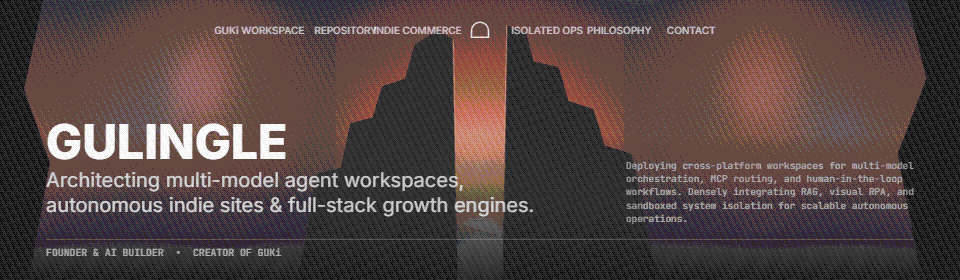
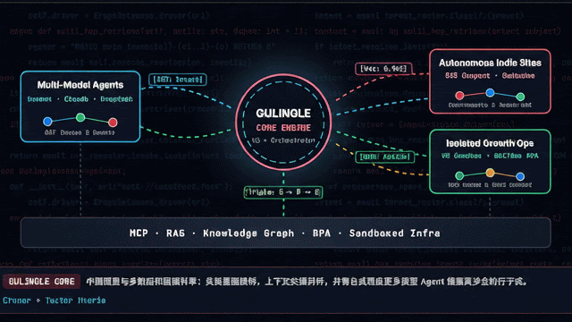

<!-- Hero Banner: Cinematic Editorial Header (assets/banner.gif) -->

 

<!-- Social & Flagship Links -->

  
  
  
  

---

### 🚀 What I'm Building · 核心构建方向

<table>
  <tr>
    <td width="50%" valign="top">
      <h4>🧠 GUKi — Multi-Model Agent Workspaces</h4>
      
Cross-platform desktop workspaces for multi-model orchestration, MCP tool routing, and human-in-the-loop agent workflows. <i>(Private for now — public updates will appear here when they are ready.)</i>

      <blockquote>跨平台多模型协作工作台，聚焦模型统一调度、MCP 工具链与人机协同。目前仍为私有项目，公开内容会在准备好后发布。</blockquote>
    </td>
    <td width="50%" valign="top">
      <h4>🌐 Autonomous Indie Sites</h4>
      
Self-operating site and commerce infrastructure: RAG knowledge-base support, tool-calling AI assistants, and automated order pipelines.

      <blockquote>独立站与商业站点基建：知识库支持、工具调用型助手，以及订单自动化闭环。</blockquote>
    </td>
  </tr>
  <tr>
    <td width="50%" valign="top">
      <h4>⚙️ Full-Stack Growth &amp; Isolated Ops</h4>
      
Sandboxed execution environments, browser &amp; desktop visual RPA agents, and resilient automation for scalable operations.

      <blockquote>隔离执行环境、浏览器与桌面智能体，以及可规模化的自动化运维。</blockquote>
    </td>
    <td width="50%" valign="top">
      <h4>📡 Engineering Philosophy</h4>
      
Isolate complexity at the infrastructure layer so autonomous AI agents can execute cleanly and reliably at the surface.

      <blockquote>在底层基础设施封装复杂性与隔离边界，让上层智能体可以干净、可靠地运行。</blockquote>
    </td>
  </tr>
</table>

---

### 🧩 System Architecture & Knowledge Graph · 系统架构蓝图

  

---

### 🛠️ Tech Stack & Infrastructure · 技术栈矩阵

- **AI & Agent Routing:**
  
  
  
  
  

- **Full-Stack Web:**
  
  
  
  
  

- **Commerce & Infra:**
  
  
  
  

---

### 📊 GitHub Analytics · 实时开发数据

  
  
   
  

